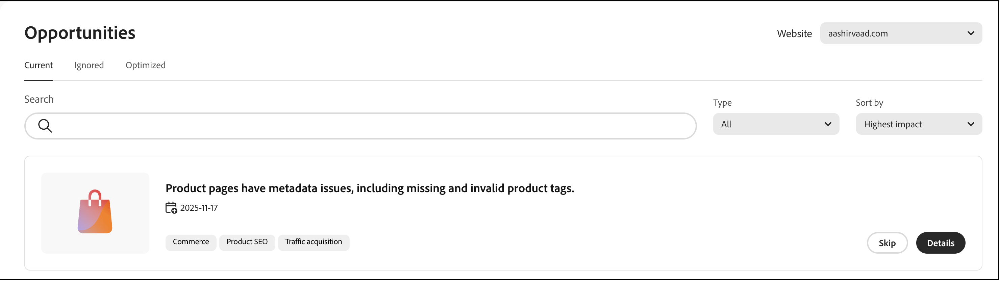
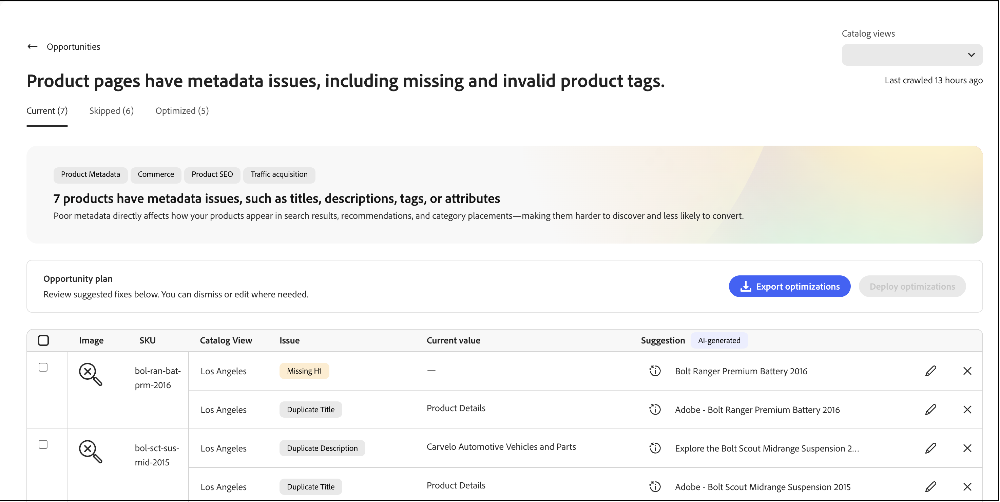
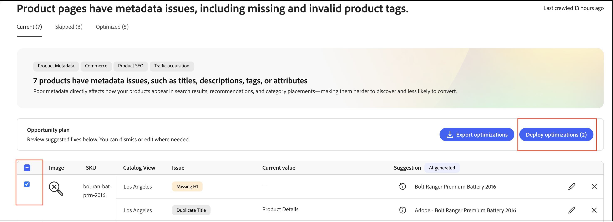
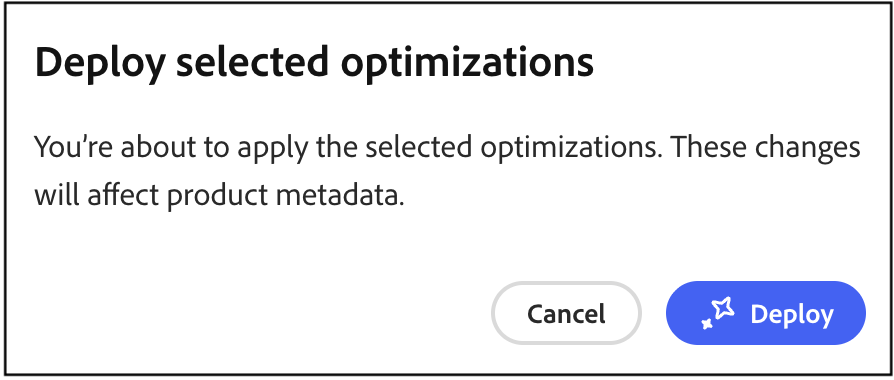
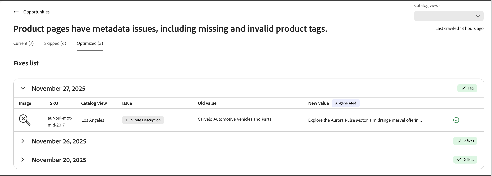

# Opportunities

The **Opportunities** page helps you identify and implement optimizations to improve site traffic, user engagement, and conversion rates through integration with Adobe Sites Optimizer.

## Access the Opportunities workspace

How you open the *Opportunities* workspace depends on the product you use:

- **Adobe Commerce Admin** (Adobe Commerce as a Cloud Service)—Select *Merchandising* > **Opportunities**.
- **Adobe Commerce Optimizer Studio**—Select *Manage Results* > **Opportunities**.

## What are Opportunities?

[Opportunities](https://experienceleague.adobe.com/en/docs/experience-manager-sites-optimizer/content/documentation/opportunities/overview){target="_blank"} are AI-powered recommendations that help merchandisers identify and address issues impacting their commerce site performance. These recommendations are powered by [Adobe Experience Manager Sites Optimizer](https://experienceleague.adobe.com/en/docs/experience-manager-sites-optimizer/content/home){target="_blank"}, a cloud-based service that analyzes and improves website performance.

## Key capabilities

- **Automated issue detection**—Sites Optimizer continuously scans product catalogs, search logs, and recommendation data to identify problems affecting discovery.
- **AI-driven recommendations**—Receive intelligent suggestions to resolve detected issues.
- **Impact categorization**—Issues are categorized by business impact (Search, Recommendations, Browse/Navigation, Product Data Quality).
- **Dashboard reporting**—View issue trends, top impacted products or queries, and improvements over time.

## Get started

To enable Opportunities, contact your customer success manager (CSM). Opportunities are available with the **Ultima** Adobe Sites Optimizer license.

## Quick tour

The Opportunities page is organized into three tabs that help you manage optimization recommendations:

- **Current (Active)**—Displays newly detected opportunities that require review and action. These items are active issues that can impact your site performance.
- **Skipped**—Contains opportunities that you have chosen to dismiss or postpone. You can move opportunities here if they are not relevant to your current business objectives.
- **Optimized (Done)**—Shows opportunities that have been successfully addressed through auto-fix deployment. Any opportunities manually addressed do not appear on this tab. This tab helps you track your auto-fixed opportunities over time.

## Auto-detect workflow

The auto-detect workflow uses AI-powered analysis to identify optimization opportunities automatically across your product catalog. This automated scanning process continuously monitors your product data, search logs, and recommendation performance to detect issues that can impact site performance, SEO, and customer engagement.

### How it works

Auto-detect leverages Adobe Experience Manager Sites Optimizer to:

- **Analyze product pages**—The system examines the top 200 pages and filters for product detail pages to identify optimization targets.
- **Extract metadata**—Meta tags (titles, descriptions, H1 headers) are extracted from each page for analysis.
- **Generate AI recommendations**—Extracted data is processed through Adobe's AI workflow to create actionable optimization suggestions.
- **Populate opportunities**—Auto-detected suggestions appear in the **Current (Active)** tab for your review.

### Prerequisite

Before auto-detect can generate recommendations, your catalog data must be synchronized and up-to-date to ensure accurate recommendations.

### What happens next

Once auto-detect identifies optimization opportunities, you can:

- Review suggested optimizations in the **Current (Active)** tab.
- Deploy fixes automatically using the [auto-fix workflow](#auto-fix-workflow) (for supported [opportunity types](#supported-opportunity-types)).
- Implement changes manually in your Commerce Admin.
- Ignore opportunities that do not align with your business objectives.

## Auto-fix workflow

The auto-fix workflow allows you to deploy AI-generated optimizations quickly with a single click. When you apply an auto-fix, the system creates a catalog optimization layer that overrides specific product attributes without modifying the original product data. Your original product data remains intact, allowing you to apply optimizations in a safe manner and revert changes at any time. See [How catalog layers work with auto-fix](#how-catalog-layers-work-with-auto-fix) to learn more.

### Supported opportunity types

The following lists the supported opportunity types:

- Title too long
- Title too short
- Duplicate Title
- Missing Title
- Empty Title
- Description too long
- Description too short
- Missing Description
- Empty Description
- Duplicate Description
- Missing H1
- Duplicate H1
- H1 too long

>[!NOTE]
>
>Multiple H1 headers on a page are currently not supported.

### Prerequisites

Before using auto-fix, ensure:

- Your product catalog is fully ingested into the Adobe Merchandising Services data layer.
- The opportunity type supports auto-fix (some optimization types require manual implementation).
- You have appropriate permissions to create and manage catalog layers.

>[!IMPORTANT]
>
>The auto-fix feature requires a fully ingested product catalog. If your catalog is not yet ingested, you can still view opportunities and implement fixes manually using the provided CSV file. Note that manual implementations are not tracked in the **Optimized (Done)** tab.

### Deploy an auto-fix optimization

To implement an AI-suggested optimization, follow these steps:

1. From the **[!UICONTROL Opportunities]** workspace, in the **Current (Active)** tab, review available optimization suggestions.

1. Select an opportunity.

    

   >[!NOTE]
   >
   >The **Deploy Optimization** button is available only for [supported suggestion types](#supported-opportunity-types). For unsupported types, the checkbox is disabled, and you must apply fixes manually in your catalog.

1. Click **Deploy optimization** then click **Deploy** to trigger the auto-fix process.

    

   The system performs the following actions in the background:

   - Creates a new catalog layer for the product (if one does not already exist).
   - Updates the relevant attribute (such as meta title, description, or H1) based on the AI recommendation.
   - Assigns the new layer as the highest priority (higher number) in the catalog view.
   - Validates the change through the catalog storefront service.

1. Monitor the deployment status. The system updates the suggestion status automatically once validation is complete.

1. Once optimized, the suggestion moves to the **Optimized (Done)** tab with a status indicator:

   - **Green checkmark**—The optimization layer is set as the first priority and is actively applied to your storefront.
   - **Warning icon**—The layer exists but is not the top priority, meaning that it can be overridden by another layer.

   

>[!NOTE]
>
>Auto-fix supports metadata optimization for sites in any language. Sites Optimizer analyzes product detail pages in their original language, generates localized AI recommendations, and creates catalog layers based on the source locale configured in your catalog view.

### How catalog layers work with auto-fix

If an Adobe Sites Optimizer layer does not exist in your catalog view, auto-fix automatically creates one and assigns it as the highest priority (highest number). If you delete this layer, it will be recreated the next time auto-fix runs and will shift existing layers to lower order numbers. If the Adobe Sites Optimizer layer already exists at a different order number, auto-fix does not change its priority. If you want to keep an auto-fix layer, but not use it immediately, you can disable the layer. Learn more about how to manage [catalog layers](/help/optimizer/setup/catalog-layer.md#manage-layer-activation-and-deletion).

The diagram shows a single row called **ASO Optimization**. This entry represents all opportunities you choose to auto-fix. Whether you auto-fix a single opportunity or multiple opportunities, they all appear in this single **ASO Optimization** row. Layers are specific to each catalog view, so the **Los Angeles** catalog view shown here applies its **ASO Optimization** layer only when that view is active.

### Important considerations

Keep the following in mind when using auto-fix:

- The status shown for each suggestion reflects the state at the time the auto-fix worker ran. The status does not update dynamically if you manually reorder catalog layers afterward.

- To ensure your optimizations remain active, avoid manually changing catalog layer priorities after deploying auto-fix recommendations.

### Troubleshooting

If an optimization does not appear to be applied on your storefront:

1. Check the status indicator in the **Optimized (Done)** tab.
1. If you see a warning icon, verify the catalog layer priority settings.
1. Ensure the optimization layer is set as the highest priority (highest number) in your catalog view.
1. Confirm that catalog data synchronization is active and up-to-date.
1. Allow time for changes to propagate. Even with a properly configured layer at the highest order number, changes can take time to appear on your storefront, similar to the delay when publishing new products.

## How Sites Optimizer and success metrics work together

Success metrics help monitor key performance indicators, such as product discovery and catalog business efficiency. Opportunities within Sites Optimizer let you know how you can boost SEO, load speed, accessibility, and engagement. Together, merchandisers and marketers can improve operational efficiency, bringing faster end-to-end performance and conversion gains with minimal IT support. To learn how you can take advantage of these two technologies to improve your storefront performance and experience, see [Using Success Metrics and Sites Optimizer together](/help/optimizer/manage-results/success-metrics.md#using-success-metrics-and-sites-optimizer-together).

## Learn more about Sites Optimizer

For detailed information about Sites Optimizer capabilities and features, see the [Adobe Experience Manager Sites Optimizer documentation](https://experienceleague.adobe.com/en/docs/experience-manager-sites-optimizer/content/home).

Additional resources:

- [Opportunity types](https://experienceleague.adobe.com/en/docs/experience-manager-sites-optimizer/content/documentation/opportunities/overview)—Learn about available optimization opportunities.
- [Sites Optimizer capabilities](https://experienceleague.adobe.com/en/docs/experience-manager-sites-optimizer/content/documentation/basics)—Explore what Sites Optimizer can do.

## More like this

- [Success Metrics](/help/optimizer/manage-results/success-metrics.md)—Monitor key performance indicators.
- [Search Performance](/help/optimizer/manage-results/search-performance.md)—Analyze search terms and optimize relevance.
- [Recommendation Performance](/help/optimizer/manage-results/recommendation-performance.md)—Monitor recommendation effectiveness.
