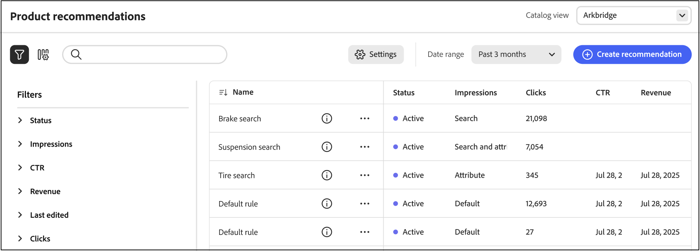
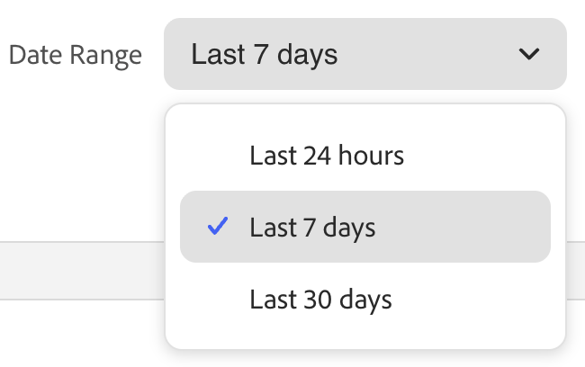

# Recommendations Performance

The Recommendations Performance page displays a list of configured recommendations along with key metrics to help you evaluate their effectiveness. You can configure the view to display metrics for the past day, week, or month. These insights show how often each recommendation unit is viewed or clicked, helping you assess performance and identify opportunities for optimization.

>[!INFO]
>
>A recommendation unit is a widget that contains the recommended product _items_.

{zoomable="yes"}

## View a report

1. Choose the **Catalog view**, such as *All views* where your recommendations apply.

   Learn more about [catalog views](#select-catalog-view) in recommendations.

1. Click the **[!UICONTROL Date Range]** and select one of the following ranges:

   

   The recommendation table updates to display metrics for that date range and catalog view.

## Customize table

1. In the upper-left corner, click the  icon to customize the table.

   The visible columns have a check mark.

1. In the menu, do either of the following:

   - To show a hidden column, click any column name without a check mark.
   - To hide a visible column, click any column name with a check mark.

   The table is refreshed to include only the selected columns.

## View details

1. In the table, click the () icon next to the recommendation that you want to examine.

1. To change the status of the recommendation, click **Activate** or **Deactivate**.

## Create or manage recommendations

Learn how you can [create a new or manage an existing](../merchandising/recommendations/create.md) recommendation.

## Workspace controls

|Control|Description|
|---|---|
||Determines the range of time that is used for metrics calculations.|
||Determines the columns that appear in the Recommendations table.|
|Create recommendation|Opens the [Create New Recommendation](../merchandising/recommendations/create.md) page.|
|[Catalog view](#select-catalog-view)|Select the catalog view to filter the table to show only those recommendations that apply to the selected catalog view. This selection is also used as the catalog view when you [create](../merchandising/recommendations/create.md) a new recommendation. Options are *All views* or a specific [catalog view](../setup/catalog-view.md).|

## Column descriptions

|Column|Description|
|---|---|
|Name|The name of the recommendation.|
|Page|The page where the recommendation appears.|
|Type|The recommendation type.|
|Status|The recommendation status. Options: Inactive/Active/Draft|
|Created|The date the recommendation was created.|
|Last Edited|The date the recommendation was last edited.|
|Impressions|The number of times a recommendation unit is loaded and rendered on a page. A recommendation unit that is below the fold of the browser's viewport is rendered on the page, even if it is not viewed by the shopper. In this case, the rendered unit is counted as an impression, but a view is counted only if the shopper scrolls the unit into view.|
|vImpressions|(Viewable Impressions) The number of recommendation units that register at least one view. For example, if the recommendation unit has two lines, each with two products, and the last two products are not seen by the shopper but the first two are, the activity will still count as an impression.|
|Views|The number of recommendation units that appear in the viewport of the shopper's browser. If the shopper scrolls the page up or down several times, the event fires multiple times, each time the unit is viewable.|
|Clicks|The sum of the number of times a shopper clicks an item in the recommendation unit and the number of times the shopper clicks the **Add to cart** button in the recommendation unit|
|Revenue|The revenue driven by the recommendation for the current time range.|
|Lt Revenue|(Lifetime Revenue) The lifetime revenue driven by a recommendation.|
|Viewability|The percentage of recommendation units that register for the view.|
|CTR|(Click-Through Rate) The percentage of unit impressions for the recommendation that register a click. CTR counts all impressions even if the unit does not enter the shopper's view. If the recommendation unit is not viewed, it is unlikely to get clicked. However, those unseen impressions count toward the CTR score and reduce the overall CTR percentage.|
|vCTR|(Viewable Click-Through Rate) measures clicks based only on viewable impressions (recommendations that actually appeared in the visible part of the shopper's screen), providing a more accurate gauge of shopper engagement.|

## Select catalog view

The **[!UICONTROL Catalog view]** selector on the **Recommendations** page does two things:

1. **Filters the table** – Shows only recommendations (and their metrics) that apply to the selected catalog view.
1. **Sets the scope for new recommendations** – When you [create](../merchandising/recommendations/create.md) a recommendation, the selected catalog view is used as the unit's scope. Options are *All views* or a specific [catalog view](../setup/catalog-view.md). 

   - **All views** – The recommendation applies to all catalog views (product availability is still filtered per view).
   - **Catalog view** – The recommendation applies only to the selected catalog view (for example, one storefront, language, or brand).

By specifying a catalog view for each recommendation, you can:

- Configure recommendations for all catalog views (global) or for one catalog view.
- Preview and filter products by catalog view on the [create](../merchandising/recommendations/create.md) recommendation page.
- Show only products that are available to each storefront.
- View metrics and storefront behavior per catalog view.

### How the catalog view filters products

Product availability is enforced per catalog view even for recommendation units under the **All views** selection. This works in addition to any [inclusion or exclusion filters](../merchandising/recommendations/filters.md) you set on the recommendation unit.

**Example: Recommendation with inclusion filters under the All views selection**

- **All views** recommendation includes SKUs: SKU_ABC, SKU_CDE, SKU_XYZ.
- **Catalog view: Kingsbluff** cannot sell SKU_ABC or SKU_CDE. **Shown:** Only SKU_XYZ, provided it satisfies all other enabled filters.
- **Catalog view: Arkbridge** cannot sell any of the included SKUs. **Shown:** No recommendation unit, because no SKU satisfies both the inclusion filter and catalog-view availability.
