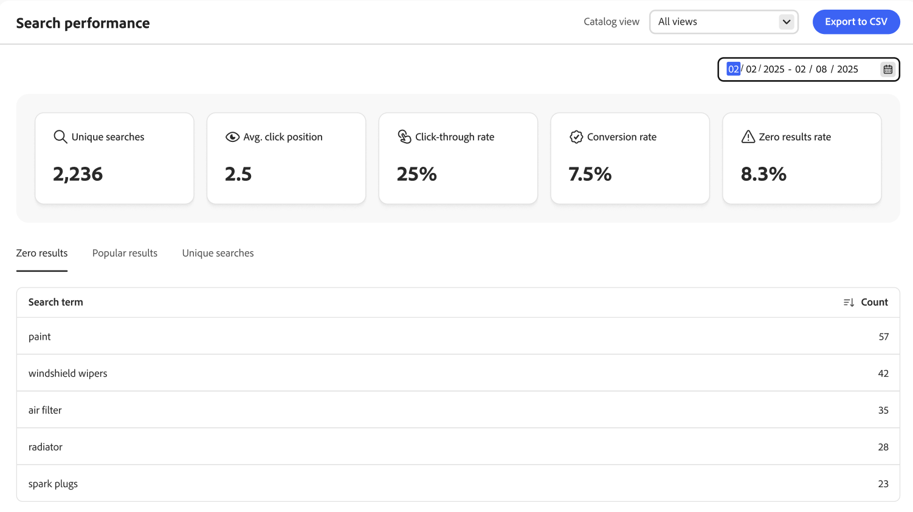
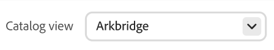

# Search Performance

The *Search performance* page provides insight into the search terms that shoppers use. The information can be used to identify trends, increase click-through, and improve the conversion rate. The Search performance page provides a snapshot of search metrics for a specific date range and includes the following reports:

- Unique searches
- Average click position
- Click-through rate
- Conversion rate
- Zero results rate

{zoomable="yes"}

>[!IMPORTANT]
>
>If you do not see any search performance metrics, make sure search event data is being [collected](../setup/events/overview.md).

>[!NOTE]
>
>To understand how product discovery ranks **exact and near matches**, same-field matches, and broader matches (and how that interacts with keyword weights and merchandising rules), see [Search matching and ranking](search-relevance-matching.md).

## Access the Search performance workspace

How you open the *Search performance* workspace depends on the product you use:

- **Adobe Commerce Admin** (Adobe Commerce as a Cloud Service)—Select *Reports* > **Search performance**.
- **Adobe Commerce Optimizer Studio**—Select **Search performance** from the root menu.

## Choose the **Catalog view**

Select the [catalog view](../setup/catalog-view.md) to see specific search performance results.

## View a report

Click the calendar and do one of the following:

- To specify a single date, double-click the date on the calendar.
- To specify a range of dates, click the first and last date on the calendar.

>[!NOTE]
>
>The range of dates cannot exceed one year.

Click **[!UICONTROL Export to CSV]** to generate a CSV file of your search performance.

## How to improve search performance

The following section provides strategies you can use to enhance your site search functionality, ensuring a seamless and efficient shopper experience that maximizes conversion rates.

There are several key factors that determine the relevance and effectiveness of search results:

- Well-structured product data ensures that search algorithms can effectively match products to queries. Low quality product data leads to less relevant search outcomes. To impact the success of your merchandising strategy directly:
    - Configure [semantic search](../setup/semantic-search.md) for natural-language and intent-based matching.
    - Set up the correct [attributes as searchable](https://developer.adobe.com/commerce/services/reference/rest/#operation/createProductMetadata) with their corresponding weight.
    - Make sure that data within those attributes is relevant.
- A well-designed search experience builds trust with customers and instills confidence that they can find what they need.
- Search rules are critical as they can elevate the visibility of certain products based on popularity, new arrivals, promotional criteria or any other merchandising strategy to meet your business requirements.
- Faceted navigation allows shoppers to refine their search and get relevant results quickly.

### Monitor search results

To optimize search results, monitor relevant Key Performance Indicators (KPIs) such as unique queries, average click position, click-through rates, conversion rate, and zero results rate to understand shopper search interactions. This data guides you to update and refine your search rules regularly.

- **Unique Searches** - The count of distinct search queries performed on your site. The system counts each unique search only once, even if the same shopper or different shoppers repeat it multiple times. This metric helps you understand the diversity of search terms used by customers and provides insights into what products or information shoppers are seeking. Tracking unique searches allows you to:

    - Identify popular search trends and frequently searched items.
    - Detect potential gaps in your product catalog or content.
    - Optimize your search functionality by adding [synonyms](../merchandising/synonyms/overview.md), creating, or updating [search rules](../merchandising/rules/overview.md).

- **Average Click Position** - Indicates the average position of search results clicked by shoppers after performing a search query on your site. This metric provides insights into the relevance and effectiveness of your search results.

    A lower average click position (closer to 1) suggests that shoppers find relevant results quickly, indicating that your search strategy is effective. It helps you understand shopper behavior and how far they are willing to scroll to find the desired product. If the average click position is high, it may indicate that the most relevant results are not appearing at the top, which necessitates a review and optimization of your search strategy.

- **Click-Through Rate (CTR)** - Measures the percentage of shoppers who click on a search result after performing a search query. A high CTR indicates that the search results are relevant and appealing to shoppers, as they are clicking on the results they find. Monitoring CTR can help identify areas for improvement. Low CTR suggests that search results are not matching shopper intent, prompting a need to refine search rules, enhance product data, or improve result presentation.

- **Conversion rate** - Indicates the effectiveness of your search feature in driving sales and achieving business goals. It reflects the overall effectiveness of your search functionality in meeting shopper needs and facilitating a smooth shopping experience. A high conversion rate indicates that your search results are highly relevant and persuasive, leading shoppers to complete purchases. If the conversion rate is low, it suggests issues with search relevance, product availability, or the overall shopper journey from search to purchase.

- **Zero results rate** - Measures the percentage of search queries on your site that return no results. This metric is crucial for understanding how often shoppers' searches are unsuccessful and can provide insights into potential gaps in your product catalog or search setup. A high zero results rate can frustrate shoppers, leading to a poor shopping experience and potential loss of customers. It can indicate missing products or categories in your catalog that shoppers are searching for, guiding inventory and product listing decisions.

    To reduce the zero results rate, you can:

    - Confirm [semantic search](../setup/semantic-search.md) is enabled on the **[Advanced search](../settings.md#advanced-search)** tab in Settings. Semantic search is enabled by default. No storefront or developer changes are required. Results update after indexing completes.
    - Offer alternative or related search terms, such as [synonyms](../merchandising/synonyms/overview.md) when no exact matches are found.
    - Regularly review zero result queries to identify patterns and make necessary adjustments to your product catalog and search settings.

You can use this metric data to optimize your search functionality in the following ways:

- Implement rules to rank popular products higher in search results automatically. Products frequently clicked on or purchased can be given priority to appear at the top. Manually curate lists of popular products for specific search queries and ensure that these items are prominently displayed.
- Highlight products that are currently trending or have recently seen a spike in popularity. This approach is effective during seasonal events, holidays, or promotional periods. To achieve this use the intelligent ranking that better suits your use case and business requirements when setting up a search rule.
- Highlight popular filters or facets. If shoppers frequently filter by certain brands or price ranges, make those options more prominent by pinning those facets and sorting them accordingly.
- When a search yields zero results, use popular results data to suggest alternative products or related categories that have high shopper engagement.
- Analyze popular search terms and product data to identify important keywords. Optimize your product searchable attributes with these keywords to improve search relevance.
- Regularly analyze your results data to understand changing trends, shopper preferences and behavior, identify top search terms, and detect issues. Use this feedback loop to refine and improve your search rules and product offerings continuously

## Optimize your search functionality

To optimize your search functionality, use [synonyms and spellings](../merchandising/synonyms/overview.md) to ensure that shoppers find products even if they use different words and [facets](../merchandising/facets/overview.md) to allow shoppers to narrow down search results.

## Improve search result relevance

To improve search result relevance, implement effective [search rules](../merchandising/rules/overview.md) and use product metadata to ensure accurate and detailed [attributes are searchable](https://developer.adobe.com/commerce/services/reference/rest/#operation/createProductMetadata).

### Images

Make sure that configurable products' child products have images with the correct roles. Having parent or child products might result in the search result not having images.

>[!NOTE]
>
>Images in search results might differ depending on the search term. If the search term determines that a child product is more relevant, images from the child product are used instead of images from the parent product.

### Leverage Product Metadata

Ensure that accurate and detailed product [attributes are set up as searchable and have an assigned weight](https://developer.adobe.com/commerce/services/reference/rest/#operation/createProductMetadata). Note that SKU, name, and category attributes are searchable by default and cannot be excluded from search. For best results, do not use spaces in your SKUs.

To increase search relevance, assign a weight to each searchable attribute. Attributes with a higher weight should appear higher within the search results. Sorting by relevance is affected by multiple criteria, such as search weight. This means that sometimes attributes with lower search weight can still have more relevance than attributes with higher search weight. Other criteria can include the number of matches in any given attribute, position of found search term, and overall text structure before and after a search term.

Ensure that each product has relevant content within each searchable attribute. It is not recommended to set an attribute as searchable if it has large amounts of content as that can reduce search result relevance.

## Field descriptions

| Snapshot data | Description |
|--- |--- |
| Unique searches | The total number of unique searches for the specified date range. Multiple searches by the same shopper, even if for the same query, are considered unique if submitted more than one hour apart. |
| Click-through rate | The percentage of searches that conclude with the shopper clicking a product. For example, the click-through rate is 50% if the shopper searches for "pants" and "shirt" and then clicks one result in the "shirt" search. |
| Conversion rate | The percentage of products the shopper purchases versus the number of products the shopper clicks for the specified date range. For example, the conversion rate of the interaction is 100% if the shopper views six products in the popover, clicks one, and makes a purchase.   The conversion rate is not affected by the number of views of a given product. For example, the conversion rate remains the same if the shopper uses search, but does not click any products. |
| Zero results rate | The percentage of unique searches that returns no results for the specified date range. For example, the zero results rate is 66.67% if the shopper searches for "fjjajfjfjf" twice (without results) and for "pants" once (with results). |
| Avg. click position | The relative position of the average click-through rate based on unique searches for the specified date range. |

| Reports | Description|
|--- |--- |
| Zero results | Lists the search queries that return no results and the number of times used during the specified date range. Report limit: Top 500 terms |
| Popular results | Lists the names of products that received the most views during the specified date range. Popular results are calculated based on impressions only and are not affected by the number of clicks or revenue generated. Report limit: Top 500 terms |
| Unique searches | Lists the unique search queries used during the specified date range. The report data is calculated the same way as unique search snapshot data. If a shopper types the same search query twice, but more than an hour apart, the search is considered to be two unique searches. Report limit: Top 500 terms |

## Default non-system attribute properties

The following table shows the default search and filterable properties of non-system attributes. To make the attribute searchable, set the *Use in Search* attribute property to `Yes`.

| Attribute Code | Searchable |
|--- |--- |
| activity | Yes |
| attributes_brand | Yes |
| brand | Yes |
| climate | Yes |
| collar | Yes |
| color | Yes |
| cost | Yes |
| eco_collection ||
| gender | Yes |
| manufacturer | Yes |
| material | Yes |
| purpose | Yes |
| strap_bags | Yes |
| style_general | Yes |

## Default system attribute properties

The following table shows the default search and filterable properties of system attributes.

| Attribute Code | Searchable |
|--- |--- |
| allow_open_amount | Yes |
| description | Yes |
| name | Yes |
| price | Yes |
| short_description | Yes |
| sku | Yes |
| status | Yes |
| tax_class_id | Yes |
| url_key | Yes |
| weight | Yes |
