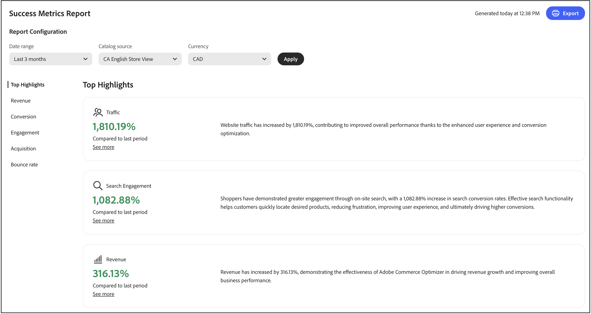
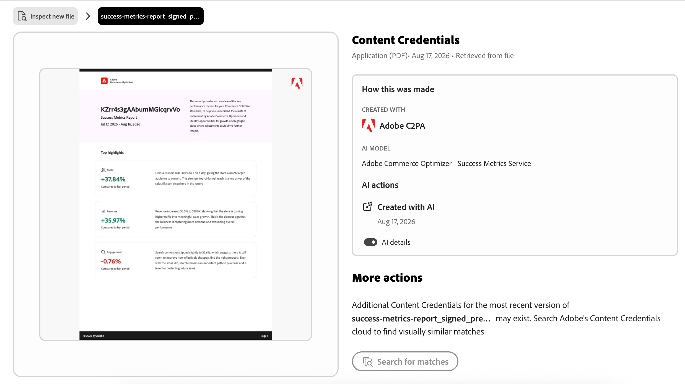
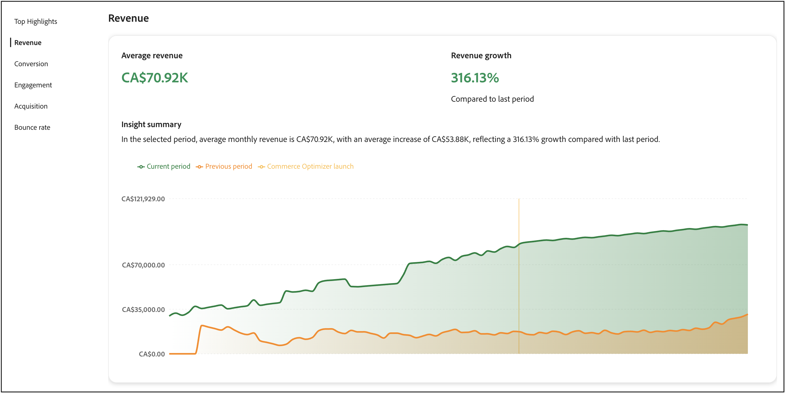
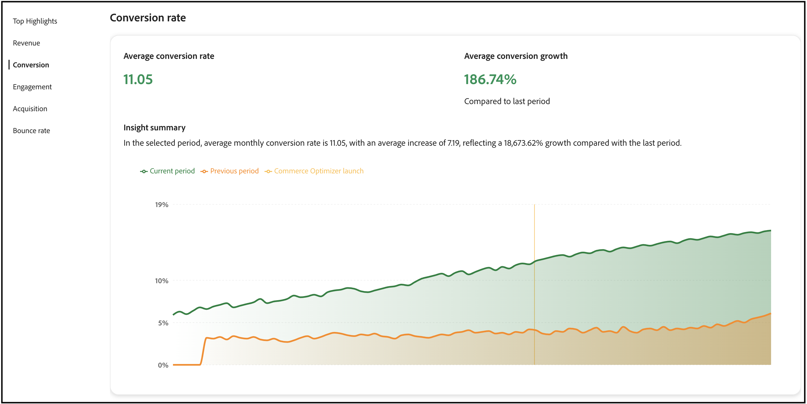
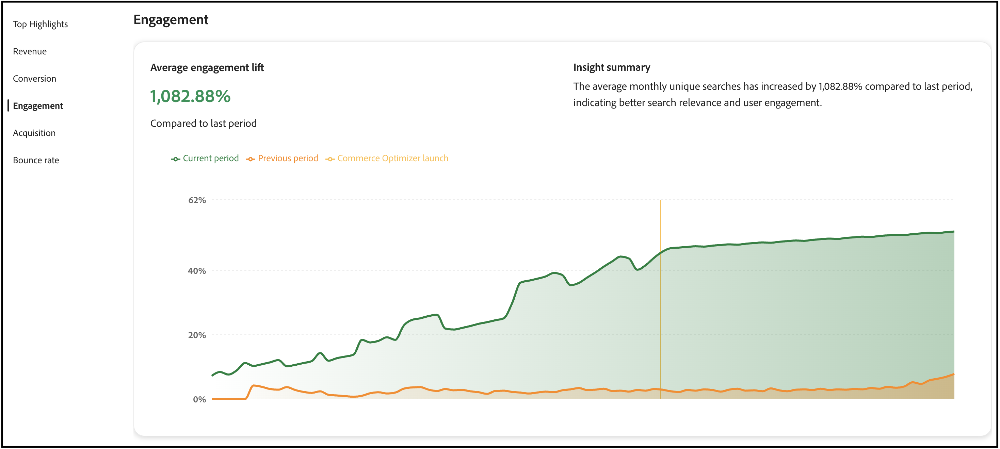
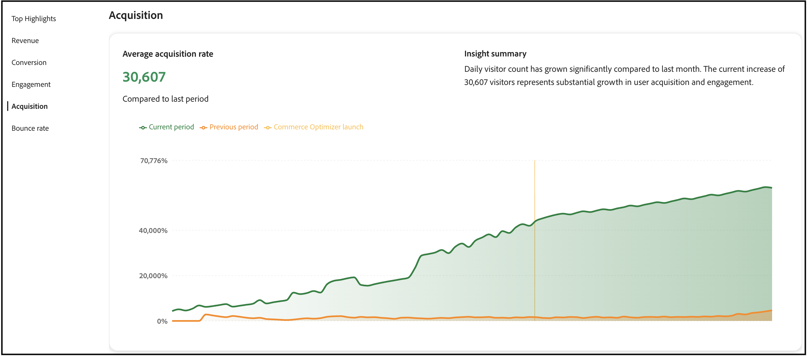
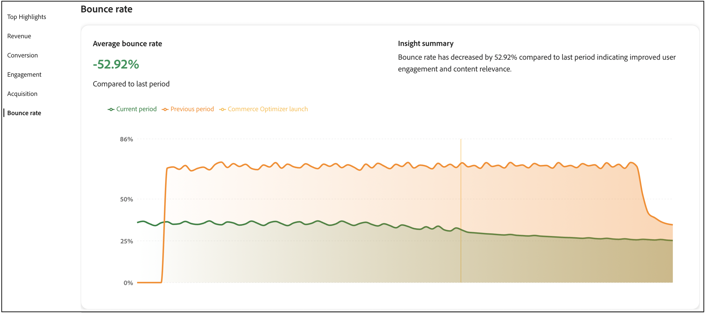

# Success metrics

This page provides an overview of the key performance metrics for your store. The goal is to understand the results of implementing Merchandising Services with the composable catalog data model (CCDM) to identify growth opportunities and areas for optimization.



The metrics in the report are pulled from storefront event data. [Learn more](../setup/events/overview.md) about the event data collected.

## Access the Success Metrics workspace

How you open the *Success Metrics* workspace depends on the product you use:

- **Adobe Commerce Admin** (Adobe Commerce as a Cloud Service)—Select *Reports* > **Success Metrics**.
- **Adobe Commerce Optimizer Studio**—Select **Success Metrics** from the root menu.

## Understanding your metrics

The success metrics report delivers actionable insights into five key performance areas that directly impact your business outcomes. Each metric reveals patterns in customer behavior and store performance that help you uncover opportunities and address challenges. Leverage these insights to drive smarter decisions and to optimize your commerce experience.

**Top Highlights** summarizes key metrics from each performance area. Use this section to identify your biggest opportunities for improvement quickly.

The key performance indicators are:

- **Revenue**—Your primary financial metric showing total sales performance.
- **Conversion**—The percentage of visitors who complete purchases.
- **Engagement**—How actively users interact with your site.
- **Acquisition**—The effectiveness of your customer acquisition efforts.
- **Bounce Rate**—The percentage of visitors who leave after viewing only one page.

### Data freshness and accuracy

**Update frequency:** Success Metrics data is processed and updated regularly as storefront events are collected and processed.

**When to check metrics:** For the most accurate trend analysis, review metrics after sufficient time has passed to collect meaningful data. Daily fluctuations are normal; focus on weekly or monthly trends for strategic decisions.

**Data accuracy:** Metrics are calculated from actual customer interactions captured through storefront events. Ensure your store has proper [event tracking configured](../setup/events/overview.md) for accurate reporting.

## Generate a report

1. From the **[!UICONTROL Success Metrics]** workspace, under **Report Configuration**, specify the **Date range**, **Catalog source**, based on your locale setting, and **Currency**.
1. Click **[!UICONTROL Apply]**.

    The **Top Highlights**, **Revenue**, **Conversion**, **Engagement**, **Acquisition**, and **Bounce rate** all update based on your report configuration.

1. Click **[!UICONTROL Export]** to save the report as a PDF.

## C2PA metadata on exported reports {#c2pa-metadata-on-exported-reports}

The Success Metrics report includes highlights and summaries using generative AI. When you export a report to PDF, Adobe automatically attaches C2PA metadata to the exported file.

C2PA metadata is tamper-evident, machine-readable metadata based on the [C2PA open standard](https://c2pa.org/). The metadata records that the report content was created with generative AI, which AI model was used, and when it was created.

>[!NOTE]
>
>C2PA metadata is attached automatically. No additional action is required, and this behavior cannot be turned off. C2PA metadata does not change how your report looks. It is invisible metadata carried within the PDF.

**What this means for your exported reports**

- When you export a Success Metrics report to PDF, the exported file carries C2PA metadata.
- C2PA metadata travels with the PDF when you share or download it. Third-party platforms that support C2PA metadata may read this metadata and display transparency information to viewers.
- You can verify the C2PA metadata attached to any file by uploading it to [Inspect](https://contentauthenticity.adobe.com/inspect).



Learn more about [Generative AI content transparency](https://experienceleague.adobe.com/en/docs/cx-enterprise-ai/experience-cloud-ai/overview/content-transparency).

## Using Success Metrics and Sites Optimizer together

Success Metrics and Sites Optimizer ([Opportunities](opportunities.md)) are complementary tools designed to work together, helping you to enhance your commerce site's performance. Understanding the difference between these features helps you make better decisions and achieve measurable results.

### Key differences

|Aspect|Success Metrics|Sites Optimizer (Opportunities)|
|---|---|---|
|**Purpose**|Measures performance and outcomes|Identifies issues and provides recommendations|
|**Type**|Analytical dashboard|Proactive issue detection|
|**What it shows**|Key performance indicators (Revenue, Conversion, Engagement, Acquisition, Bounce Rate)|AI-powered recommendations for problems affecting site performance|
|**Data source**|Storefront event data|Product catalogs, search logs, recommendation data|
|**Use when**|You want to track results over time|You want to identify and fix specific issues|

### How to use these features together

The most effective approach combines both tools in a continuous improvement cycle:

1. **Measure with Success Metrics**: Start by reviewing your Success Metrics dashboard to understand your current performance. Identify which KPIs need improvement (for example, low conversion rate or high bounce rate).

1. **Diagnose with Opportunities**: Navigate to the Opportunities page to discover specific issues that can be causing poor performance. Sites Optimizer scans your product catalog, search logs, and recommendation data to identify problems such as missing product data, poor search relevance, or navigation issues.

1. **Implement recommendations**: Follow the AI-driven recommendations provided in Opportunities to address detected issues. These recommendations might include fixing product data quality issues, improving SEO, or optimizing search and discovery.

1. **Track improvements**: Return to Success Metrics to monitor how the changes impact your KPIs over time. Use the date range selector to compare performance before and after implementing recommendations.

1. **Iterate and optimize**: Continue this cycle, using Opportunities to identify new issues and Success Metrics to measure the impact of your optimizations.

### Example workflow

A merchant notices their conversion rate declining in Success Metrics. Here's how they can use both features to address it:

1. **Identify the problem**: The Success Metrics dashboard shows conversion rate dropped 15% over the past month.

1. **Find the cause**: The Opportunities page reveals several issues:
   - Multiple products missing key attributes affecting search relevance.
   - Popular search queries returning poor results.
   - Slow page load times on category pages.

1. **Take action**: The merchant prioritizes fixing the product data quality issues first, as Sites Optimizer categorizes these as high-impact opportunities affecting search and recommendations.

1. **Measure results**: After updating product attributes and implementing recommended changes, the merchant monitors Success Metrics weekly. Over the next month, conversion rate increases by 12%, and search engagement metrics improve.

1. **Continue optimizing**: With conversion rate improving, the merchant shifts focus to the next priority shown in Opportunities—optimizing page load speed to reduce bounce rate.

### When to use each feature

**Use Success Metrics when you want to:**

- Track overall business performance.
- Measure the impact of changes over time.
- Identify which areas of your business need attention.
- Share performance reports with stakeholders.
- Understand customer behavior trends.

**Use Sites Optimizer (Opportunities) when you want to:**

- Discover specific issues affecting performance.
- Get actionable recommendations to fix problems.
- Understand why certain metrics are declining.
- Prioritize which optimizations to tackle first.
- Leverage AI to identify issues you might miss manually.

Together, these features provide a complete solution: Success Metrics tells you *what* is happening, while Sites Optimizer tells you *why* and *how to fix it*.

## Next steps and optimization strategies

Use your success metrics data to identify opportunities for improvement and implement targeted optimization strategies. The following sections provide specific, actionable guidance for each metric area.

>[!BEGINTABS]

>[!TAB Revenue optimization]

For revenue, your goal is to increase total sales and average order value.



### Understanding the revenue metric

**What it measures:** Total income generated by your store during the selected time period.

**How it's calculated:** Revenue is the sum of all completed orders (base price × quantity) for all products sold during the reporting period. The calculation uses data from `place-order` events captured on your storefront.

>[!IMPORTANT]
>
>Revenue calculations exclude canceled orders, returns, and orders where the `place-order` event was not captured. Events may be missing due to consent settings, browser issues (ad blockers, script failures), or technical processing errors. 

**Formula:**

```
Total Revenue = Sum of (Product Base Price × Quantity) for all completed orders
```

**Data source:** Storefront events (specifically `place-order` events)

**What's included:**

- All completed orders during the selected date range.
- Base product prices multiplied by quantities purchased.
- Revenue from all sales channels backed by Merchandising Services with CCDM.

**Important notes:**

- Revenue is calculated based on base prices captured in storefront events.
- The date range you select in the report configuration determines the reporting period.
- Revenue metrics update as new order events are processed.

### Strategies

- **Implement AI-powered recommendations**: Use the Merchandising Services recommendation engine to surface relevant products that drive higher conversion rates. Deploy *Customers who viewed this also viewed* and *Bought this, bought that* recommendation types to increase cross-selling opportunities.

- **Create merchandising rules**: Boost high-margin products in search results using [merchandising rules](../merchandising/rules/overview.md). Pin best-selling items to the top of search results for high-traffic queries.

- **Optimize product discovery**: Use [intelligent facets](../merchandising/facets/overview.md) to help customers find products more efficiently, leading to higher conversion rates and increased revenue.

- **Leverage seasonal opportunities**: Create time-based merchandising rules to promote seasonal or promotional items during peak shopping periods.

>[!TAB Conversion rate improvement]

To improve your conversion rate, your goal is to convert more visitors into customers.



### Understanding the conversion rate metric

**What it measures:** The percentage of visitors who view products and then complete a purchase, indicating how effectively your store converts browsers into buyers.

**How it's calculated:** Conversion rate compares the number of unique visitors who purchased products against the number of unique visitors who viewed products.

**Formula:**

```
Conversion Rate = (Total Number of Orders ÷ Total Unique Visitors) × 100
```

**Data source:** Storefront events.

**How it works:**

- **Product views** are tracked when visitors view product pages (using `product-view` events).
- **Purchases** are tracked when orders are completed (using `place-order` events).
- The calculation matches users who viewed specific products with those who purchased them.

**Important notes:**

- A visitor who views multiple products but makes one purchase counts as one conversion.
- The metric tracks unique visitors using browser-based identifiers.
- Product view events always include a click, so views represent genuine user interest.

### Strategies

- **Optimize search relevance**: Implement [synonyms](../merchandising/synonyms/overview.md) to ensure that customers find what they're looking for, even with different search terms. Use dynamic faceting to provide relevant filtering options.

- **Strategic recommendation placement**: Deploy recommendation units on high-traffic pages like product detail pages and category pages. Use *Most viewed* and *Most purchased* recommendations to build trust and urgency.

- **Improve product visibility**: Use merchandising rules to ensure best-selling and high-converting products appear prominently in search results.

- **A/B test recommendation types**: Experiment with different recommendation types and placements to find what works best for your audience.

>[!TAB Engagement enhancement]

To enhance engagement, your goal is to increase customer interaction and time on site.



### Understanding the engagement metric

**What it measures:** How actively users interact with your store, tracking meaningful actions from initial browsing through the checkout process.

**How it's calculated:** Engagement tracks all interactions that indicate active participation with your store, including product browsing, shopping cart activities, and checkout actions.

**Data source:** Storefront events

**What counts as engagement:**

Engagement includes the following event categories and actions:

- **Product interactions:** Product views, product clicks, and product comparisons.
- **Shopping cart activities:** Adding items to cart, updating quantities, removing items.
- **Checkout actions:** Initiating checkout, completing checkout steps.
- **Category browsing:** Viewing category pages, filtering by facets.
- **Wishlist activities:** Adding to wishlist, viewing wishlist items.

**Event tracking details:**

The system tracks engagement when events have:

- Category: `product`, `shopper`, `shopping-cart`, or `checkout`.
- Property: `Product`, `Checkout`, `Cart`, `Category`, or `Wishlist`.

**Important notes:**

- Higher engagement typically correlates with higher conversion rates.
- Engagement metrics help identify where users are most active in their journey.
- Use engagement data to optimize high-traffic pages and improve user experience.

### Strategies

- **Diversify recommendation types**: Avoid showing the same recommendations repeatedly. Use a mix of *Recommended for you*, *Trending*, and *Recently viewed* to keep content fresh and engaging.

- **Implement intelligent search**: Use AI-driven dynamic faceting and result re-ranking to adapt search results in real-time based on shopper behavior.

- **Create personalized experiences**: Deploy "Recommended for you" units on the homepage and throughout the customer journey to provide personalized product suggestions.

- **Optimize search experience**: Use synonyms to improve search relevance and ensure customers find what they're looking for quickly.

>[!TAB Acquisition growth]

To acquire more growth, your goal is to attract more new customers and improve acquisition efficiency.



### Understanding the acquisition metric

**What it measures:** The number of new, unique visitors coming to your store, helping you understand the effectiveness of your marketing and customer acquisition efforts.

**How it's calculated:** Acquisition counts unique visitors based on browser identifiers assigned during their first visit to your store.

**Data source:** Storefront events.

**How it works:**

- Each visitor's browser receives a unique identifier (`domain_userid`) via a first-party cookie.
- New visitors are identified when their session index equals 1 (first visit).
- The system tracks these identifiers to distinguish new visitors from returning ones.

**Important notes:**

This tracking method has some known limitations:

- **Cross-device users:** The same person visiting from different devices (desktop, mobile, tablet) or browsers is counted as multiple unique visitors since each device and browser receives a different identifier.
- **Cookie clearing:** Users who clear their browser cookies are assigned a new identifier and counted as new visitors again.
- **Privacy settings:** Users with strict privacy settings or cookie blockers may not be tracked.

**Best for:**

- Tracking new visitor trends over time.
- Analyzing marketing campaign effectiveness.
- Understanding traffic growth patterns.

**Interpretation tip:** While not perfectly accurate due to the limitations above, acquisition metrics are reliable for identifying trends and comparing periods when most users browse on the same device and don't frequently clear cookies.

### Strategies

- **Leverage search performance data**: Use the [search performance](../manage-results/search-performance.md) report to identify trending products and popular search terms. Create merchandising rules to highlight these items.

- **Optimize recommendation performance**: Monitor [recommendation performance](../manage-results/recommendation-performance.md) metrics to identify which recommendation types drive the most traffic and conversions.

- **Highlight new and promotional items**: Use merchandising rules to boost new products or promotional items in search results to attract attention from new visitors.

- **Track traffic sources**: Use event data to understand which channels bring the most valuable traffic and optimize your marketing efforts accordingly.

>[!TAB Bounce rate reduction]

To reduce the bounce rate, your goal is to keep visitors engaged and reduce single-page visits.



### Understanding the bounce rate metric

**What it measures:** The percentage of visitors who leave your site after viewing only one page, indicating potential issues with user experience, page relevance, or site engagement.

**How it's calculated:** Bounce rate compares single-page sessions against total sessions to determine what percentage of visitors leave without further interaction.

**Formula:**

```
Bounce Rate = (Number of Bounced Sessions ÷ Total Sessions) × 100
```

**Data source:** Storefront events.

**How it works:**

- A **bounced session** is counted when a visitor views only one page during their entire visit.
- The system tracks page views within each session to identify single-page visits.
- Sessions are determined by user activity and time between interactions.

**What causes bounces:**

- Visitors landing on irrelevant pages (poor search/ad targeting).
- Slow page load times.
- Poor user experience or confusing navigation.
- Finding information quickly without needing to explore further.
- Technical issues or errors.

**Important notes:**

- High bounce rates aren't always negative—some pages (like contact information or specific product specs) naturally have high bounce rates.
- Compare bounce rates across different page types and traffic sources to identify problem areas.
- Sudden increases in bounce rate often indicate technical issues or poor campaign targeting.

**What's a good bounce rate?** This varies by industry and page type, but generally:

- 40-60%: Average for ecommerce sites.
- Below 40%: Excellent engagement.
- Above 70%: May indicate problems requiring investigation.

### Strategies

- **Improve search relevance**: Use synonyms and intelligent faceting to ensure customers find relevant products quickly. Poor search results are a major cause of high bounce rates.

- **Implement recommendation units**: Deploy recommendation units on category and search results pages to provide additional product options and keep visitors engaged.

- **Optimize product discovery**: Use merchandising rules to ensure the most relevant and popular products appear first in search results.

- **Create engaging homepage experiences**: Use "Recommended for you" and "Trending" recommendation types on your homepage to engage visitors with relevant content immediately.

>[!ENDTABS]

## Troubleshooting and optimization

### When metrics are declining

**Revenue declining**:

- Check if recommendation units are still active and performing well.
- Review merchandising rules to ensure high-margin products are being promoted.
- Analyze search performance to identify if popular products are still ranking well.

**Conversion rate dropping**:

- Verify that search relevance is maintained (check synonyms and facets).
- Ensure recommendation units are displaying correctly.
- Review merchandising rules for any conflicts or issues.

**High bounce rates**:

- Check search result relevance and implement synonyms if needed.
- Ensure recommendation units are loading properly.
- Review product data quality and availability.

**Low engagement**:

- Diversify recommendation types to prevent customer fatigue.
- Implement more personalized recommendation strategies.
- Optimize search experience with better facets and synonyms.

## Field descriptions

### Report configuration

| Field | Description |
| ---  | --- |
| Date range | Options include **Past 3 months**, **Past 7 days**, **Past 30 days**, **Past 6 months**, **Past 12 months**, and **Year to date**. Use shorter ranges for immediate optimization insights and longer ranges for trend analysis. |
| Country | Based on the catalog source specified for your [catalog view](../setup/catalog-view.md). Select the appropriate market for accurate performance analysis. |
| Currency | The currency specified for your catalog view. Ensure this matches your target market for accurate revenue reporting. |
| Export | Saves the report as a PDF for sharing with stakeholders or offline analysis. |

## More like this

- [Search Performance](../manage-results/search-performance.md)—Analyze search terms and optimize search relevance.
- [Recommendation Performance](../manage-results/recommendation-performance.md)—Monitor and optimize recommendation effectiveness.
- [Recommendations Overview](../merchandising/recommendations/overview.md)—Learn about AI-powered product recommendations.
- [Merchandising Rules](../merchandising/rules/overview.md)—Boost, bury, pin, or hide products in search results.
- [Facets](../merchandising/facets/overview.md)—Enhance search with intelligent filtering.
- [Synonyms](../merchandising/synonyms/overview.md)—Improve search relevance and customer experience.
- [Events Overview](../setup/events/overview.md)—Understand the data that powers your metrics.
