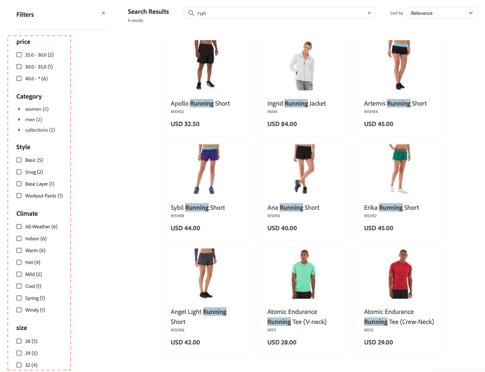

# Facets

Facets is a method of high-performance filtering that uses multiple dimensions of attribute values as search criteria.

Within a facet, shoppers can select multiple options, such as "Basic" and "Snug" under "Style" and the search results update to display only those styles. Likewise, if a shopper selects "Basic" under "Style" and "Indoor" under "Climate", the search results display those selections.

Any defined facet can be used as a URL parameter and results are filtered based on the parameter values, for example: `http://yourstore.com?brand=acme&color=red`.

## Facet aggregation

Facet aggregation is performed as follows: if the storefront has three facets (categories, color, and price) and the shopper filters on all three (color = blue, price is from $10.00-$50.00, `categories` = `promotions`)

- `categories` aggregation—Aggregates `categories`, then applies the `color` and `price` filters, but not the `categories` filter.
- `color` aggregation—Aggregates `color`, then applies  the `price` and `categories` filters, but not the `color` filter.
- `price` aggregation—Aggregates `price`, then applies the `color` and `categories` filters, but not the `price` filter.

## Default attribute values

The system enables the following product attributes by default.

| Property | Description | Attribute |
|---|---|---|
| Sortable | Used for Sorting in Product Listing | `price`|
| Searchable | Use in Search | `price`  `sku` `name`|

Learn more about product attributes and their properties:

- For deployments connected to an Adobe Commerce backend, see [Product Attributes overview](https://experienceleague.adobe.com/en/docs/commerce-admin/catalog/product-attributes/product-attributes)
- For deployments using a third-party Commerce backend, see the [Data Ingestion Metadata API](https://developer.adobe.com/commerce/services/optimizer/data-ingestion/#metadata).

## Layered search and expansion of search types

Layered search, or search within a search, is an attribute-based filtering system that extends the traditional search functionality to include additional search parameters. These additional search parameters allow more precise and flexible product discovery.

With layered search you can:

- Enable shoppers to search within the search results.
- Refine results further by using the `startsWith` and `contains` search indexation in the second layer of the layered search.

The advanced search capabilities are implemented through the `filter` parameter in the [`productSearch` query](https://developer.adobe.com/commerce/services/reference/graphql/#productsearch) using specific operators:

- **Layered search**—Search within another search context—With this capability, you can perform up to two layers of search for your search queries. For example:

  - **Layer 1 search**—Search for "motor" on `product_attribute_1`.
  - **Layer 2 search**—Search for "part number 123" on `product_attribute_2`. This example searches for "part number 123" within the results for "motor".

  Layered search is available for both `startsWith` search indexation and `contains` search indexation in the second layer of the layered search, as described below:

- **startsWith search indexation**—Search using `startsWith` indexation. This capability allows:

  - Searching for products where the attribute value starts with a specified string.
  - Configuring an "ends with" search so shoppers can search for products where the attribute value ends with a particular string.
    - To enable an "ends with" search, ingest the product attribute in reverse and use a reversed string for the API call. For example, if you want to search for a product name that ends with "pants", you need to send this as "stnap".

- **contains search indexation**—Search an attribute using contains indexation. This new capability allows:

    - Searching for a query within a larger string. For example, if a shopper searches for the product number "PE-123" in the string "HAPE-123".

        - Note: This search type is different from the existing [phrase search](https://developer.adobe.com/commerce/services/reference/graphql/#productsearch), which performs an autocomplete search. For example, if your product attribute value is "outdoor pants", a phrase search returns a response for "out pan", but does not return a response for "oor ants". A contains search, however, does return a response for "oor ants".

These new conditions enhance the search query filtering mechanism to refine search results. These new conditions do not affect the main search query.

### Implementation

1. [Set attributes as searchable](https://developer.adobe.com/commerce/services/reference/rest/#tag/Metadata).

1. Specify the search capability for that attribute, such as **Contains** (default) or **Starts with**. To enable **Contains** and **Starts with**, specify a maximum of six attributes for each. Additionally, for the **Contains** indexation, string length is limited to 50 characters or less.

1. See the [developer documentation](https://developer.adobe.com/commerce/services/reference/graphql/#productsearch) for examples of how to update your Adobe Merchandising Services GraphQL API calls using the new `contains` and `startsWith` search capabilities.

   You can implement these new conditions on your search results page. For example, you can add a new section on the page where the shopper can further refine their search results. You can allow shoppers to select specific product attributes, such as "Manufacturer," "Part Number," and "Description." From there, they search within those attributes using the `contains` or `startsWith` conditions.

### When to use layered search rather than facets

Layered search and facets serve different purposes in product discovery, and choosing between them depends on your specific use case:

**Use layered search to:**

- Search within search results using multiple criteria
- Work with part numbers, SKUs, or technical specifications where users know partial information
- Allow shoppers to narrow down results step-by-step with nested criteria
- Reduce the number of API calls by combining multiple search criteria in a single query
- Implement business-specific search patterns that go beyond standard faceted navigation

**Use facets to:**

- Provide typical category, price, brand, and attribute filtering
- Offer intuitive filter options that users can easily understand and select
- Show available options based on current search results
- Display filter counts and ranges that help users understand available options
- Work with common product characteristics like color, size, and material

**Best practice:** Use layered search for complex, technical searches where users have specific criteria, and use facets for standard e-commerce filtering where users want to explore and refine options visually.
