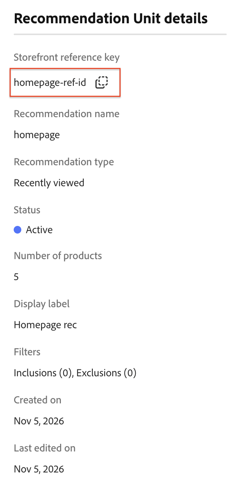
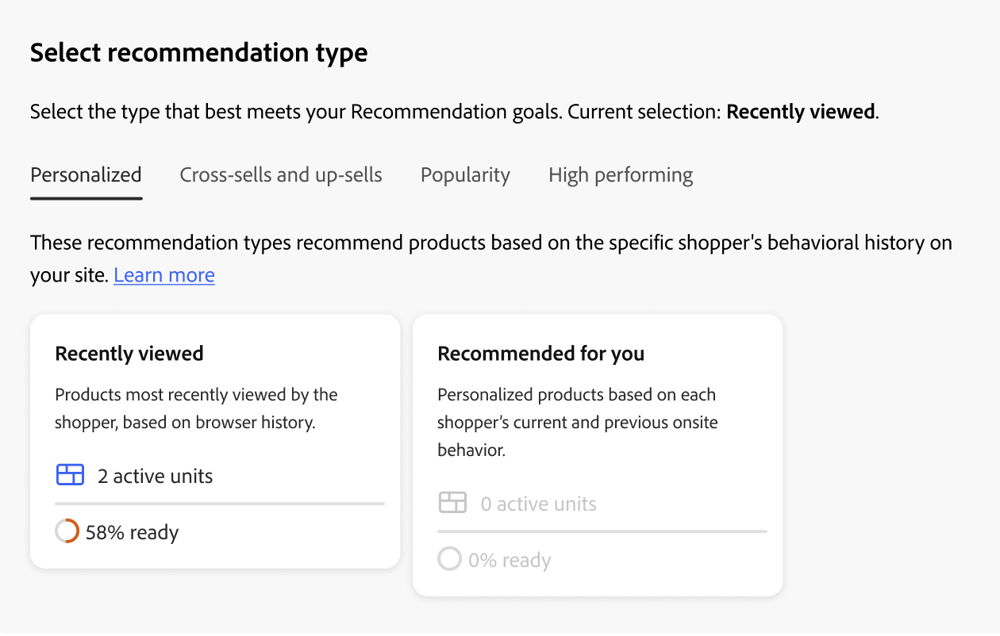

# Create and Manage Recommendations

When you create a recommendation, you create a _recommendation unit_, or widget, that contains the recommended product _items_.

_Recommendation unit_

When you activate the recommendation unit, Adobe Commerce starts to [collect data](/help/optimizer/manage-results/recommendation-performance.md) to measure impressions, views, clicks, and so on. The Recommendations table displays the metrics for each recommendation unit to help you make informed business decisions.

1. From the menu, go to _Merchandising_ > **Recommendations** to display the _Recommendations_ workspace.

1. In the **Catalog view** field, select the catalog view where you want the recommendation to be available. Learn more about [using catalog views for recommendations](/help/optimizer/manage-results/recommendation-performance.md#select-catalog-view).

1. Click **Create recommendation**.

   The recommendation you create is available in the catalog view you previously selected.

1. In the _Name your Recommendation_ section, enter a descriptive name for internal reference, such as `Home page most popular`.

1. In the **Storefront reference** section, enter a reference key to identify this recommendation unit in your storefront configuration. After you create the recommendation, you can [copy its value](#get-the-storefront-reference-key) from the **Recommendation Unit details** and use it as the `referenceKey` in the recommendations block. The Reference Key is for storefront configuration; the Storefront display label is the text shoppers see.

1. In the _Select Recommendation type_ section, specify the [type of recommendation](types.md) you want based on your strategy.

1. In the _Storefront display label_ section, enter the [label](best-practice.md#recommendation-labels) that is visible to your shoppers, such as "Top sellers".

1. In the _Choose number of products_ section, use the slider to specify how many products you want to appear in the recommendation unit.

   The default is `5`, with a maximum of `20`.

1. (Optional) In the _Filters_ section, [apply filters](filters.md) to control which products appear in the recommendation unit.

1. Use the _Recommended products preview_ panel to understand better how filters affect what products are displayed in the recommendation unit. Learn more about how to [preview recommendations](#preview-recommendations).

1. When complete, click one of the following:

   - **Save as draft** to edit the recommendation unit later. You cannot modify the recommendation type for a recommendation unit in a draft state.

   - **Activate** to enable the recommendation unit on your storefront.

   Your recommendation appears in the Recommendations workspace. To use your recommendation on your storefront, you need the [recommendation ID or reference key](#get-the-storefront-reference-key).

>[!NOTE]
>
>You can create up to 50 active recommendation units. See [Limits and boundaries](/help/optimizer/boundaries-limits.md) for details.

>[!IMPORTANT]
>
>Some browsers can block critical scripts that prevent Recommendations from working as expected.

## Preview recommendations

The _Recommended products preview_ panel is always available with a sample selection of products that can appear in the recommendation unit when it is deployed to the storefront.

To test a recommendation when working in a non-production environment, you can fetch recommendation data from a different source. This allows merchants to experiment with rules and preview the recommendations before deploying to production.

|Field|Description|
|---|---|
|Catalog view||
|Name|The name of the product.|
|SKU|The Stock Keeping Unit assigned to the product|
|Price|The price of the product.|
|Result Type|Primary - Indicates that there is enough training data collected to display a recommendation. Backup - Indicates that there is not enough training data collected so a backup recommendation is used to fill the slot. Go to [Behavioral Data](/help/optimizer/setup/events/overview.md) to learn more about machine learning models and backup recommendations.|

To get immediate real-time feedback about the products that will be included, experiment with the recommendation type and filters as you create your recommendation unit. To meet your business needs, configure the recommendation unit as you begin to understand which products appear.

[!DNL Product Recommendations] [filter](filters.md) recommendations to avoid displaying duplicate products when multiple recommendation units are deployed on a single page. As a result, the products that appear in the preview panel can differ from those that appear in the storefront.

For multi-storefront, multi-language, or multi-brand setups, you can configure whether each recommendation applies to all catalog views (global) or to a single [catalog view](/help/optimizer/setup/catalog-view.md). Learn more about how to [set the catalog view](/help/optimizer/manage-results/recommendation-performance.md#select-catalog-view) when working with recommendations.

## Get the storefront reference key

After creating a recommendation, use its reference key to configure the recommendation unit on your storefront.

1. On the **Recommendations** page, click the information icon () next to the recommendation name to open the **Recommendation Unit details** page.

   

1. Copy the value from the **Storefront reference key** section.

1. In the storefront `product-recommendations` block, use this reference key to configure the [recommendation drop-in](https://experienceleague.adobe.com/en/tools/commerce-storefront/merchants/blocks/product-recommendations/) on your Edge Delivery Services storefront.

## Manage existing recommendations

You can edit, deactivate, or delete an existing recommendation.

1. From the menu, go to _Merchandising_ > **Recommendations**.

1. Select the recommendation that you want to modify.

1. Click the () more selector.

1. In the menu, you can **Deactivate**, **Delete**, or **Edit** the recommendation. If you select **Edit**, you can adjust the following settings as needed:

   - Recommendation name
   - Reference Key
   - Storefront label
   - Number of products
   - Filter products

   You cannot change the recommendation type or the catalog view. Catalog view is set when you create the recommendation. To learn more, see [select catalog view](/help/optimizer/manage-results/recommendation-performance.md#select-catalog-view).

1. When complete, click **Save Changes**.

## Readiness indicators

Readiness indicators show which recommendation types perform best based on the catalog and behavioral data available. They can also help you identify potential issues with [event collection](/help/optimizer/setup/events/overview.md) or determine whether a recommendation type is not receiving enough traffic to generate results.

Readiness indicators are categorized into either [static-based](#static-based) or [dynamic-based](#dynamic-based). Static-based recommendations use catalog data only; whereas dynamic-based recommendations use behavioral data from your shoppers. That behavioral data is used to [train machine learning models](/help/optimizer/setup/events/overview.md) to build personalized recommendations and to calculate their readiness score.

### How readiness indicators are calculated

The readiness indicators are an indication of how much the model is trained. Indicators are dependent upon the types of events collected, the breadth of products interacted with, and the size of the catalog.

The readiness indicator percentage is derived from a calculation that indicates how many products can be recommended depending on the recommendation type. Statistics are applied to products based on the overall catalog size, interaction volume (views, clicks, add-to-carts), and the percentage of SKUs that register those events within a certain time window. For example, during peak holiday season traffic, the readiness indicators can show higher values than in times of normal volume.

As a result of these variables, the readiness indicator percent can fluctuate. This fluctuation explains why recommendation types change between being "Ready to deploy" and not.

Readiness indicators are calculated based on several factors:

- Sufficient result set size: Are there enough results being returned in most scenarios to avoid using [backup recommendations](/help/optimizer/setup/events/overview.md#backup-recommendations)?
- Sufficient result set variety: Do the products being returned represent a variety of products from your catalog? The goal with this factor is to avoid having a minority of products as the only items recommended across the site.

Based on the above factors, a readiness value is calculated and displayed as follows:

- 75% or higher means that the recommendations suggested for that recommendation type are highly relevant.
- At least 50% means that the recommendations suggested for that recommendation type are less relevant.
- Less than 50% means that the recommendations suggested for that recommendation type may not be relevant. In this case, [backup recommendations](/help/optimizer/setup/events/overview.md#backup-recommendations) are used.

Learn more about [why readiness indicators can be low](#what-to-do-if-the-readiness-indicator-is-low).

### Static-based

The following recommendation types are static-based because they only require catalog data. No behavioral data is used.

- _More Like This_

### Dynamic-based

The following recommendation types are dynamic-based because they use storefront behavioral data.

Last six months of storefront behavioral data:

- _Viewed this, viewed that_
- _Viewed this, bought that_
- _Bought this, bought that_
- _Recommended for you_

Last seven days of storefront behavioral data:

- _Most Viewed_
- _Most Purchased_
- _Most Added to Cart_
- _Trending_
- _View to Purchase Conversion_
- _View to Cart Conversion_

Most recent shopper behavioral data (only views):

- _Recently Viewed_

### Visualize progress

To help you visualize the training progress of each recommendation type, the _Select Recommendation type_ section displays a measure of readiness for each type.

_Recommendation type_

>[!NOTE]
>
>Indicators may never reach 100%.

The readiness indicator for recommendation types that depend on catalog data does not change much since the merchant's catalog rarely changes. But the readiness indicator for recommendation types based on shopper behavioral data can change often depending on daily shopper activity.

#### What to do if the readiness indicator is low

A low readiness percentage indicates that there are not many products from your catalog that are eligible to be included in recommendations for this recommendation type. This means that there is a high probability that [backup recommendations](/help/optimizer/setup/events/overview.md#backup-recommendations) are returned if you deploy this recommendation type anyway.

>[!IMPORTANT]
>
>Any SKUs with spaces can reduce recommendation relevancy and should be avoided.

The following lists possible reasons and solutions to common low readiness scores:

- **Static-based**—Missing catalog data for the displayable products causes low percentages for these indicators. If they are lower than expected, a full sync can fix this issue.
- **Dynamic-based**—The following factors cause low percentages for dynamic-based indicators:

   - Missing fields in the required [storefront events](/help/optimizer/setup/events/overview.md) for the respective recommendation types (requestId, product context, and so on).
   - Low traffic to the store so the volume of behavioral events received is low.
   - The variety of storefront behavioral events across different products in your store is low. For example, if only ten percent of your products are viewed or bought most of the time, then the respective readiness indicators are low.
