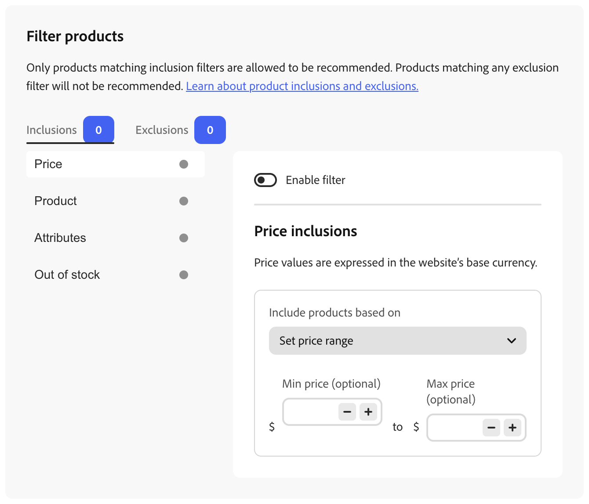
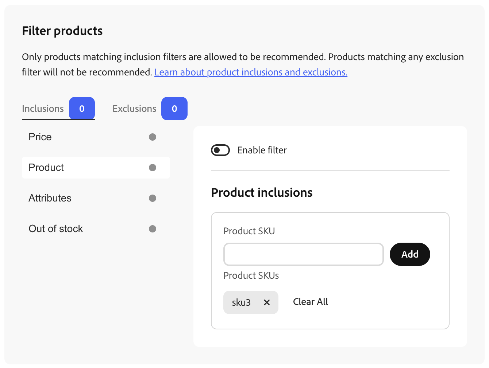
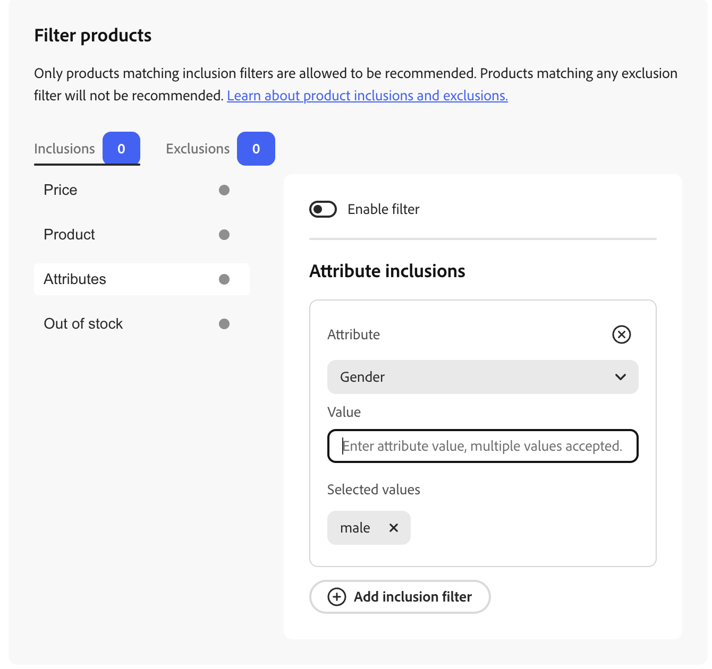
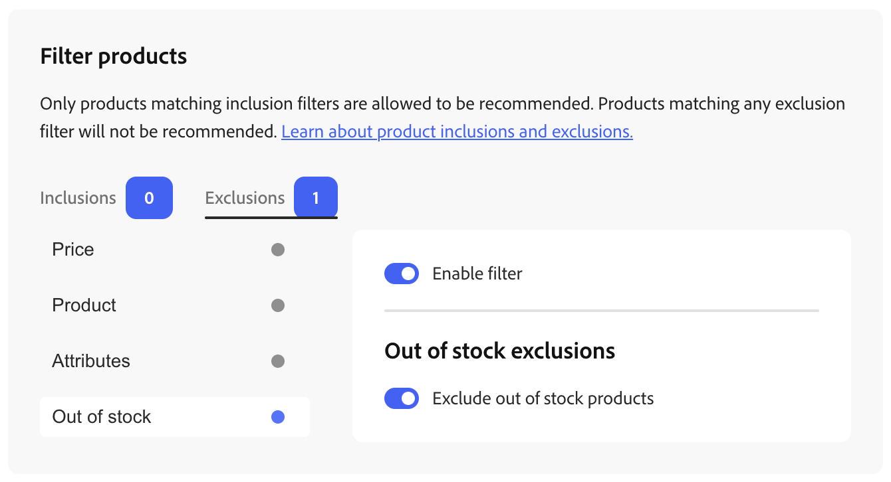

# Filter Products

[!DNL Product Recommendations] automatically applies non-configurable default filters to recommendation units. If you have multiple recommendation units deployed to a page, [!DNL Product Recommendations] filters out any products that are repeated in the units. Only the first reference to a repeated product is used, to make room for other products to be recommended. [!DNL Product Recommendations] also filters out any previously purchased products and those that are in the cart.

When you [create](create.md) a recommendation unit, you can define filters that control which products can be displayed in recommendations. These filters are based on a set of inclusion or exclusion conditions that you define. Only products that match all inclusion conditions appear in recommendations. Products that match any of the exclusion conditions are not recommended.

You can configure multiple filters and enable only those you want by selecting the toggle on each filter page. This allows you to create drafts of filters for future use. The number of enabled filters is displayed on each tab.

## Conditions

Conditions can be static or dynamic.

- A static condition uses existing product attributes to determine which products can appear in the unit. For example, you can specify that only in-stock products with a price greater than $25 appear in the unit.

- A dynamic condition is based on a shopper's current context, such as the currently viewed category or product. For example, when creating a product recommendation to be deployed on product detail pages, you can use a [dynamic price filter](#dynamic-price-filters-relative-to-current-product) to include or exclude products within a relative price range of the currently viewed product.

### Logical operators

The logical operators `AND` and `OR` are used to join multiple conditions. If using both inclusion and exclusion filters across filter types, inclusions are evaluated first to determine all possible products that can be recommended, then products that match any exclusion filters are removed from the list. **Price** filters use a different order among price rules: exclusions first, then inclusions. See [How include and exclude rules use price](#how-include-and-exclude-rules-use-price).

- `AND`—Joins two inclusion-filtering conditions
- `OR`—Joins two exclusion-filtering conditions

## Types of filters

Each filter type targets a different aspect of the catalog, such as product and price, so you can narrow or broaden which products are eligible for a unit. Choose the types that match your merchandising goals, then combine inclusion and exclusion conditions as needed; the subsections below describe how each type behaves and how [!DNL Product Recommendations] applies it.

>[!NOTE]
>
>Only products that match your **inclusion** filters can be recommended, and any product that matches an **exclusion** filter is removed.

### Price {#price}

>[!IMPORTANT]
>
>Price filtering is in beta.

Price filtering uses each product's **final computed price** from the storefront's **active price book**, which is the price book assigned to the storefront where the recommendation unit is rendered.

That value:

- **Includes** discounts, promotions, and special pricing defined in that price book (not list price alone).
- **Excludes** shipping and cart-level adjustments.
- **Applies only** to the active price book for that storefront; other storefronts or price books are not used.

Configure how price books map to a storefront in your [price books](/help/optimizer/setup/pricebooks.md) setup.

#### How include and exclude rules use price {#how-include-and-exclude-rules-use-price}

- **Exclusion rules** – Products whose final price **matches any** defined price exclusion are removed first.
- **Inclusion rules** – Among the remaining candidates, only products whose final price **matches all** defined price inclusion conditions stay eligible. That includes every enabled inclusion filter (for example, your price rule plus any other inclusion rules).

Price rules **filter** the recommendation candidate set; they do **not** re-rank products. The engine produces a ranked list, price include and exclude rules remove products from that list, and the relative order of remaining products stays the same. If fewer products qualify than the unit requests, only valid items are shown. If none qualify, the unit is not rendered (no empty placeholder).

The price shown on products inside the recommendation unit is the same **final price** from that storefront's price book, so what shoppers see matches the value used for filtering. In the Admin preview, configurable products can show a price range when variant prices differ; see [Configurable products in preview](#configurable-products-in-preview).

#### Static price range

Use a **static** price filter when you want a fixed minimum or maximum in your store's base currency, independent of the product a shopper is viewing.

##### Set up a static price filter

1. While [creating or editing](create.md) a recommendation unit, open **[!UICONTROL Filter products]** (or go to the _Filters_ step from the unit workflow).
1. Select the **[!UICONTROL Inclusions]** or **[!UICONTROL Exclusions]** tab, depending on whether you want to allow only products in a price range or block products in a range. The badge on each tab shows how many filters of that type are enabled.
1. In the list on the left, select **[!UICONTROL Price]**.
1. Turn **[!UICONTROL Enable filter]** on.

   Price values use the **website's base currency**, as noted on the page.

1. Open **[!UICONTROL Include products based on]** (on the **[!UICONTROL Inclusions]** tab) or the equivalent control on the **[!UICONTROL Exclusions]** tab, and choose **[!UICONTROL Set price range]**.
1. Set an optional **[!UICONTROL Min price]** and/or **[!UICONTROL Max price]** using the fields next to the currency symbol. You can type amounts or use the **-** and **+** controls to adjust values. Leave a bound empty if you do not need a minimum or maximum. The range is compared to each product's final computed price for the storefront's active price book.
1. Finish configuring the recommendation unit and save or publish so the filter takes effect.

#### Dynamic price filters (relative to current product) {#dynamic-price-filters-relative-to-current-product}

Use a **dynamic** price filter to limit recommendations relative to the **currently viewed product** on a product detail page (PDP). The filter uses that product's final price as an **anchor** and compares recommended products against boundaries you define.

Dynamic operators are available only for [SKU-related recommendation types](types.md) that run in a product context:

- Viewed this, viewed that
- Viewed this, bought that
- Bought this, bought that
- More like this
- Visual similarity

They are **not** available for popularity-based types because those units do not have a single current product to anchor the filter:

- Most viewed
- Most purchased
- Most added to cart
- Trending
- Recommended for you
- Recently viewed
- View to cart conversion
- View to purchase conversion

On the storefront, the recommendation drop-in reads the current product's price from the PDP context and sends it with the recommendation request. [!DNL Product Recommendations] uses that value as the anchor when evaluating dynamic price rules. For configurable products, the anchor is the **lowest variant** final price (`priceRange.minimum`).

##### Operators

In **[!UICONTROL Include products based on]** (or the exclusions equivalent), you can choose:

| Operator | Purpose |
| --- | --- |
| **Less than or equal to current product price** | Include or exclude products at or below a boundary derived from the anchor price plus an offset. |
| **Greater than or equal to current product price** | Include or exclude products at or above a boundary derived from the anchor price plus an offset. |
| **Within a value range of current product** | Include or exclude products whose final price falls within a fixed currency band around the anchor (offsets from the current price). |
| **Within a percentage range of current product** | Include or exclude products whose final price falls within a percentage band around the anchor. |

##### Offset semantics

For **Less than or equal to current product price** and **Greater than or equal to current product price**, the value you enter is a **numeric offset added to the anchor price** to form the boundary:

- A **negative** offset moves the boundary **below** the current product price.
- A **positive** offset moves the boundary **above** the current product price.
- **Empty** or **0** means **no limit** on that side; the backend treats them the same.
- You cannot use **0** to mean "exactly the current product price" as the boundary.

##### Set up a dynamic price filter

1. [Create or edit](create.md) a **SKU-related** recommendation unit that is deployed on the **product detail** page (or another placement where a current product is always in context).
1. Open **[!UICONTROL Filter products]** and select the **[!UICONTROL Inclusions]** or **[!UICONTROL Exclusions]** tab.
1. Select **[!UICONTROL Price]** and turn **[!UICONTROL Enable filter]** on.
1. Open **[!UICONTROL Include products based on]** (or the exclusions equivalent) and choose a dynamic operator (for example, **Within a value range of current product**).
1. Enter offsets or range values as prompted. Use the preview to confirm results for a sample product.
1. Save or publish the unit.

Invalid values (non-numeric amounts, unsupported combinations, or ranges where minimum is greater than maximum) block save and show validation errors; **[!UICONTROL Save]** stays disabled until the filter is valid.

##### When no anchor price is available

If a dynamic price filter is enabled but the storefront cannot supply a current product price (for example, the unit is rendered outside a PDP context), [!DNL Product Recommendations] does not return unfiltered recommendations. The unit shows **no recommendations**, because showing unfiltered results does not match the rule you configured.

##### Configurable products in preview {#configurable-products-in-preview}

In the **preview** panel, recommended product prices display as follows:

- **Simple products** – Single final price from the GraphQL response.
- **Configurable products** – If minimum and maximum variant prices differ, the preview shows a range (for example, `$min – $max`). If they are equal, a single price is shown.

The anchor price used for dynamic filter calculations on a configurable product is always the **minimum** variant final price, consistent with the storefront.

#### Price filter examples

The following examples use a current product price of **$500**. To match your merchandising goal, adjust inclusion versus exclusion.

| Operator | Tab | Goal | Example boundary |
| --- | --- | --- | --- |
| Less than or equal to current product price | Exclusions | Promote upsell by hiding lower-priced alternatives | Exclude products ≤ $500 |
| Less than or equal to current product price | Inclusions | Offer budget-friendly alternatives | Include products ≤ $500 |
| Greater than or equal to current product price | Exclusions | Avoid upsell in a budget-focused flow | Exclude products ≥ $500 |
| Greater than or equal to current product price | Inclusions | Surface premium alternatives | Include products ≥ $500 |
| Within a value range of current product | Exclusions | Diversify away from similar price points | Exclude $400–$600 |
| Within a value range of current product | Inclusions | Show comparable alternatives in a narrow band | Include $400–$600 |
| Within a percentage range of current product | Exclusions | Reduce similarly priced items (for example ±20%) | Exclude roughly $400–$600 |
| Within a percentage range of current product | Inclusions | Fair comparison within a comparable band | Include roughly $400–$600 |

### Product

Product filters target individual catalog items by **SKU**. To allow or block specific products, use the **[!UICONTROL Filter products]** page as [price filters](#price) to add SKUs. You cannot surface disabled products or products that are not visible individually in a recommendation unit; those products never appear on the storefront regardless of filters.

#### Set up a product filter

1. While [creating or editing](create.md) a recommendation unit, open **[!UICONTROL Filter products]** (or go to the _Filters_ step from the unit workflow).
1. Select the **[!UICONTROL Inclusions]** or **[!UICONTROL Exclusions]** tab. The badge on each tab shows how many filters of that type are enabled.
1. In the list on the left, select **[!UICONTROL Product]**.
1. Turn **[!UICONTROL Enable filter]** on.

   The right panel heading reflects the tab, for example **[!UICONTROL Product inclusions]** or the equivalent for exclusions.

1. In **[!UICONTROL Product SKU]**, enter a SKU and click **[!UICONTROL Add]**. Repeat to add more SKUs.

   Under **[!UICONTROL Product SKUs]**, each SKU appears as a removable tag. Click **X** on a tag to remove that SKU, or click **[!UICONTROL Clear All]** to remove every SKU from the list.

1. Finish configuring the recommendation unit and save or publish to make the filter take effect.

For **inclusions**, only products whose SKUs are listed (and that satisfy your other enabled inclusion filters) can be recommended. For **exclusions**, any product whose SKU is listed is not recommended, even if it otherwise qualifies.

>[!NOTE]
>
>Child products of a configurable product are not displayed in a recommendation unit because those child products have the visibility of _Not Visible Individually_.

### Attributes {#attributes}

>[!NOTE]
>
>Attribute filtering is in beta.

Attribute filters let you include or exclude products based on product attribute values, using the same **[!UICONTROL Filter products]** page as [price](#price) and [product](#product) filters.

#### About attribute filters

An attribute filter differs from a [product filter](#product) in that it targets products by shared attribute values rather than by individual SKU. For example, instead of listing every SKU assigned to a category, you can create a single attribute filter that matches all products assigned to that category.

#### Set up an attribute filter

Use the following steps to add an attribute inclusion or exclusion rule to a recommendation unit.

>[!TIP]
>
>For any attributes that you want to be filterable, use the [Metadata API](https://developer.adobe.com/commerce/services/reference/rest/#tag/Metadata){target="_blank"} to set the `filterable` parameter:
>
>{"filterable": true}
>
>The attribute becomes available in the **Attributes** menu the next time the catalog is synchronized with the Merchandising Services data layer.

1. While [creating or editing](create.md) a recommendation unit, go to **[!UICONTROL Filter products]**.
1. Select the **[!UICONTROL Inclusions]** or **[!UICONTROL Exclusions]** tab. The badge on each tab shows how many filters of that type are enabled.
1. In the list on the left, select **[!UICONTROL Attributes]**.
1. Choose an attribute from the selector, for example **Category**.
1. In **[!UICONTROL Value]**, enter a value for the attribute, such as **pants**.
1. Press **Enter** or click **[!UICONTROL Add inclusion filter]** (or the equivalent exclusion control) to add the attribute filter.
1. Finish configuring the recommendation unit and save or publish to make the filter take effect.

>[!NOTE]
>
>When you select an attribute whose metadata sets `number` to `true`, such as **Size**, the **Value** field displays range inputs instead of a single text value.

The attribute list depends on the **Catalog View** you selected. If you select **All Views**, the list is based on the catalog source associated with the first catalog view. If you select a specific catalog view, the list is based on that view's catalog source.

#### Use inclusion and exclusion conditions

Only products matching inclusion filters are allowed to be recommended. Products that match any exclusion filter are not be displayed in recommendations.

#### Combine conditions

When an attribute filter includes multiple values or is combined with other conditions, the following logic applies.

- If multiple values are selected for the same attribute, the values are combined with `OR`.
- Conditions on different attributes (for example, Color and Size) are combined with `AND`—a product must match all of them. If you add the same attribute as separate conditions instead of entering multiple values in one condition, those conditions are also combined with `AND`, not `OR`.
- If there are multiple exclusion conditions, a product is removed when it matches any of the exclusion conditions.
- If using both inclusion and exclusion filters, see [Logical operators](#logical-operators).

<!--
#### Availability by recommendation type

Hiding this for now as we need better clarification on what "limited" means.

Attribute filter support varies by recommendation type.

| Recommendation type | Inclusion support | Exclusion support |
| --- | --- | --- |
| Most viewed | Yes | Yes |
| Most purchased | Yes | Yes |
| Trending | Yes | Yes |
| Recommended for you | Limited | Yes |
| Viewed this, viewed that | Limited | Yes |
| Viewed this, bought that | Limited | Yes |
| Bought this, bought that | Limited | Yes |
| More like this | Limited | Yes |
| Visual similarity | No | Yes |
| Recently viewed | No | Limited |
| Recently purchased | No | Limited |
-->

#### Availability, validation, and troubleshooting

- If there are empty attribute values or invalid conditions, recommendations do not render on the storefront or in the preview panel.
- Attribute values must exactly match what is in your catalog. This includes spaces and case.
- If none of the products meet the filter criteria, recommendations do not render on the storefront or in the preview panel.

### Out of stock

The following exclusion filter can filter out products based on stock status:

- Out of stock—(Exclusion only) Excludes products that are out of stock.

