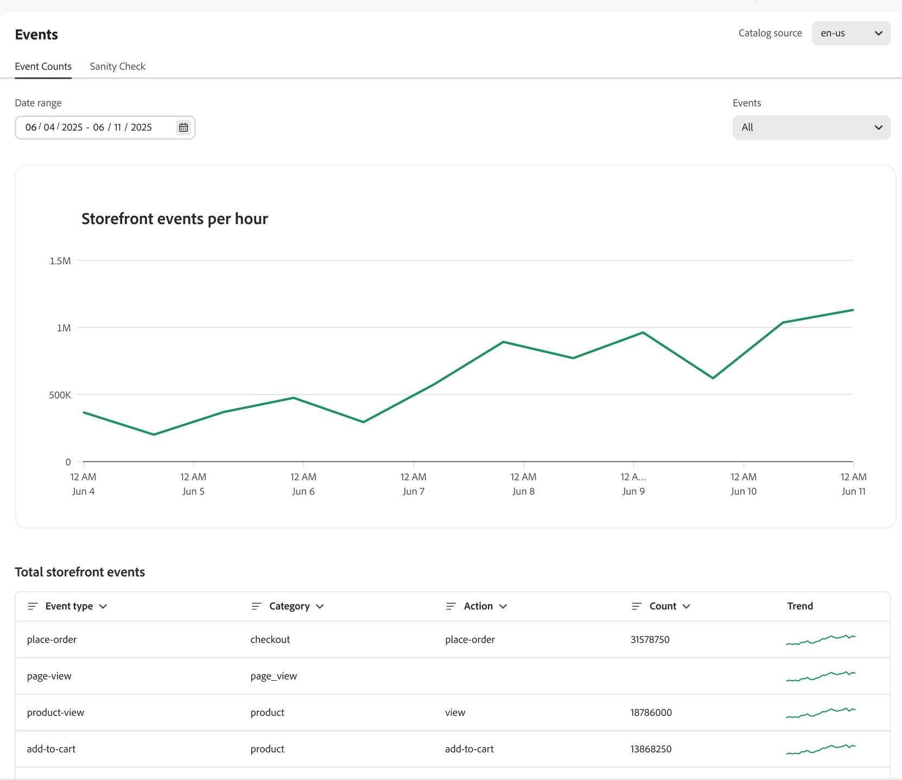
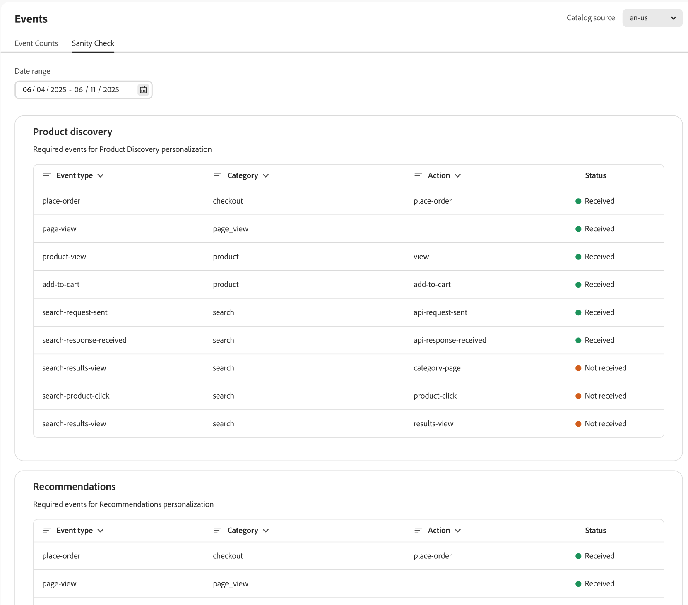

# Events

Events are a critical tool to enhance the shopping experience and drive conversions by leveraging real-time data insights.

Merchandising Services with the composable catalog data model (CCDM) deploys storefront events to your site automatically. These events capture data from shoppers' interactions on your site. This anonymized data powers [recommendations](../../manage-results/recommendation-performance.md), [product discovery](../../manage-results/search-performance.md), and [success metrics](../../manage-results/success-metrics.md).

>[!NOTE]
>
>Data collection does not include personally identifiable information (PII). All user identifiers, such as cookie IDs and IP addresses, are strictly anonymized. [Learn more](https://www.adobe.com/privacy/experience-cloud.html).

The **Events** page lets you observe the storefront event data being collected. Having a view into the event data collection lets merchants verify that they have implemented storefront events correctly and that events are being successfully captured. Merchants can use this page to identify potential problems and take steps to resolve any event issues.

## Access the Events workspace

How you open the *Events* workspace depends on the product you use:

- **Adobe Commerce Admin** (Adobe Commerce as a Cloud Service)—Select *System* > **Catalog Events**.
- **Adobe Commerce Optimizer Studio**—Select *Store setup* > **Events**.

## Event Count

The **Event Counts** tab tracks shopper interactions, such as searches, clicks, and purchases, to help you analyze trends and improve the shopping experience.

{zoomable="yes"}

|Field|Description|
|---|---|
|**Date range**|Lets you specify the date range to see a specific subset of data.|
|**Storefront events per hour**|Displays a graph showing the number of events triggered on your storefront.|
|**Total storefront events**|A filterable table that shows details for all events triggered on your storefront.|

## Sanity Check

The **Sanity Check** tab offers insights into the health of each behavioral event, ensuring accurate data collection and functionality. ​

{zoomable="yes"}

|Field|Description|
|---|---|
|**Date range**|Lets you specify the date range to see a specific subset of data.|
|**Product discovery**|Displays the required events to personalize product search results. The **Status** column indicates if the events were received.|
|**Recommendations**|Displays the required events to personalize product recommendations. The **Status** column indicates if the events were received.|

The following sections describe event details for [product discovery](#product-discovery) and [recommendations](#recommendations).

### Product discovery

Product discovery uses events to power search algorithms such as "Most Viewed", and "Viewed This, Viewed That".

This table describes the events used by product discovery [ranking strategies](../../merchandising/rules/add.md#intelligent-ranking).

| Ranking Strategy | Events | Page |
| --- | --- | --- |
| Most Viewed |  `page-view` `product-view` | Product detail page |
| Most Purchased |  `page-view` `place-order` | Cart/Checkout |
| Most added to cart |  `page-view` `add-to-cart` | Product detail page Product listing page Cart Wish List |
| Viewed this, viewed that |  `page-view` `product-view` | Product detail page |

#### Required dashboard events

Some events are required to populate the [search performance dashboard](../../manage-results/search-performance.md)

| Dashboard area        | Events      | Join field |
| ------------------- | ------------- | ---------- |
| Unique searches       |`page-view`, `search-request-sent`, `search-response-received` | `searchRequestId`  |
| Zero results searches |`page-view`, `search-request-sent`,  `search-response-received` | `searchRequestId`|

### Recommendations

There are two types of data used in recommendations:

- **Behavioral**—Data from a shopper's engagement on your site, such as product views, items added to a cart, and purchases.
- **Catalog**—Product metadata, such as name, price, availability, and so on.

Adobe AI aggregates the behavioral and catalog data, creating Recommendations for each recommendation type. The Recommendations service then deploys those recommendations to your storefront in the form of a widget that contains the recommended product _items_.

Some recommendation types use behavioral data from your shoppers to train machine learning models to build personalized recommendations. Other recommendation types use catalog data only and do not use any behavioral data. If you want to start using Recommendations quickly on your site, you can use the `More like this` recommendation type.

#### Cold start

When can you start using recommendation types that use behavioral data? It depends. This situation is referred to as the _Cold Start_ problem.

The _Cold Start_ problem refers to the time it takes for a model to train and become effective. For recommendations, this means waiting for Adobe AI to gather enough data to train its machine learning models before deploying recommendation units on your site. The more data the models have, the more accurate and useful the recommendations are. Since data collection happens on a live site, it's best to start this process early.

The following table provides some general guidance for the amount of time that it takes to collect enough data for each recommendation type:

| Recommendation type | Training Time | Notes |
|---|---|---|
|Popularity-based (`Most viewed`, `Most purchased`, `Most added to cart`) | Varies | Depends on volume of events - views are most common, and therefore learns faster; then adds to cart, then purchases|
|`Viewed this, viewed that` | Requires more training |Product views are decently high in volume|
|`Viewed this, bought that`, `Bought this, bought that`| Requires the most training |Purchase events are the most rare events on a commerce site, especially compared to product views|
|`Trending` | Requires three days of data to establish a popularity baseline| Trending is a measure of recent momentum in a product's popularity compared with its own popularity baseline. A product's trending score is computed using a foreground set (recent popularity over 24 hours) and a background set (popularity baseline over 72 hours). If the popularity of an item increases significantly within a 24 hour period as compared with its baseline popularity, then it receives a high trending score. Every product has this score, and the items with the highes score  at any time comprise the set of top trending products. |

Other variables that can impact the time needed to train:

- Higher traffic volume contributes to faster learning
- Some recommendation types train faster than others
- The system recomputes behavioral data every four hours. Recommendations become more accurate the longer they are used on your site.

To help you visualize the training progress of each recommendation type, the [create recommendation](../../merchandising/recommendations/create.md#readiness-indicators) page displays readiness indicators.

While data is being collected on your live site and the machine learning models are training, you can finish other testing and configuration tasks needed to set up recommendations. By the time you're done with this work, the models have enough data to create useful recommendations, allowing you to deploy them to your storefront.

If your site doesn't get enough traffic (views, purchases, trends) for most product SKUs, there might not be enough data to complete the learning process. This issue can make the readiness indicator on the Recommendations workspace seem stuck. The readiness indicators are meant to provide merchants with another data point in choosing what recommendation type is better for their store. The numbers are a guide and may never reach 100%. [Learn more](../../merchandising/recommendations/create.md#readiness-indicators) about readiness indicators.

#### Backup recommendations

If the input data is insufficient for providing all requested recommendation items in a unit, the system provides backup recommendations to populate recommendation units. For example, if you deploy the `Recommended for you` recommendation type to your homepage, a first-time shopper on your site has not generated enough behavioral data to recommend personalized products accurately. In this case, items are surfaced based on the `Most viewed` recommendation type to this shopper.

If input data collection is insufficient, the following recommendation types fall back to `Most viewed` recommendation type:

- `Recommended for you`
- `Viewed this, viewed that`
- `Viewed this, bought that`
- `Bought this, bought that`
- `Trending`
- `Conversion (view to purchase)`
- `Conversion (view to cart)`

#### Recommendation-specific events

The following table lists the events that are triggered when shoppers interact with recommendation units on the storefront. The event data collected powers the [metrics](../../manage-results/recommendation-performance.md) to analyze how well your recommendations are performing.

| Event | Description |
| --- | --- |
|`impression-render` | Sent when the recommendation unit is rendered on the page. If a page has two recommendation units (bought-bought, view-view), then two `impression-render` events are sent. This event is used to track the metric for impressions. |
|`rec-add-to-cart-click` | The shopper clicks the **Add to cart** button for an item in the recommendation unit. |
|`rec-click` | The shopper clicks a product in the recommendation unit. |
|`view` | Sent when the recommendation unit becomes at least 50 percent viewable, such as by scrolling down the page. For example, if a recommendation unit has two lines, a `view` event is sent when one line plus one pixel of the second line becomes visible to the shopper. If the shopper scrolls the page up and down several times, the `view` event is sent as many times as the shopper sees the whole recommendation unit again on the page.|

#### Required dashboard events

The following events are required to populate the [Recommendations Performance dashboard](../../manage-results/recommendation-performance.md)

| Dashboard column | Events    | Join field  |
| ---------------- | --------- | ----------- |
| Impressions      |`page-view`, `recs-request-sent`, `recs-response-received`, `recs-unit-render` | `unitId`  |
| Views            |`page-view`, `recs-request-sent`, `recs-response-received`, `recs-unit-render`, `recs-unit-view` | `unitId`  |
| Clicks           |`page-view`, `recs-request-sent`, `recs-response-received`, `recs-item-click`, `recs-add-to-cart-click`    | `unitId`  |
| Revenue          |`page-view`, `recs-request-sent`, `recs-response-received`, `recs-item-click`, `recs-add-to-cart-click`, `place-order` | `unitId`, `sku`, `parentSku` |
| LT Revenue       |`page-view`, `recs-request-sent`, `recs-response-received`, `recs-item-click`, `recs-add-to-cart-click`, `place-order` | `unitId`, `sku`, `parentSku` |
| CTR              |`page-view`, `recs-request-sent`, `recs-response-received`, `recs-unit-render`, `recs-item-click`, `recs-add-to-cart-click`  | `unitId`, `sku`, `parentSku` |
| vCTR             |`page-view`, `recs-request-sent`, `recs-response-received`, `recs-unit-render`, `recs-unit-view`, `recs-item-click`, `recs-add-to-cart-click` | `unitId`, `sku`, `parentSku` |

The following events are not specific to Recommendations, but are required for Adobe AI to interpret shopper data correctly:

- `view`
- `add-to-cart`
- `place-order`

#### Recommendation Type

This table describes the events used by each recommendation type.

| Recommendation Type | Events | Page |
| --- | --- | --- |
| Most Viewed | `page-view` `product-view` | Product detail page |
| Most Purchased | `page-view` `place-order` | Cart/Checkout |
| Most added to cart | `page-view` `add-to-cart` | Product detail page Product listing page Cart Wish List |
| Viewed this, viewed that | `page-view` `product-view` | Product detail page |
| Viewed this, bought that |  `page-view` `product-view` | Product detail page Cart/Checkout |
| Bought this, bought that |  `page-view` `product-view` | Product detail page |
| Trending | `page-view` `product-view` | Product detail page |
| Conversion: View to purchase |  `page-view` `product-view` | Product detail page |
| Conversion: View to purchase |  `page-view` `place-order` | Cart/Checkout |
| Conversion: View to cart |  `page-view` `product-view` | Product detail page |
| Conversion: View to cart |  `page-view` `add-to-cart` | Product detail page Product listing page Cart Wishlist |

## Support

If you notice any data discrepancies or if recommendations and search results are not working as expected, [submit a support ticket](https://experienceleague.adobe.com/en/docs/support-resources/adobe-support-tools-guide/adobe-commerce-support/adobe-commerce-help-center-user-guide).
