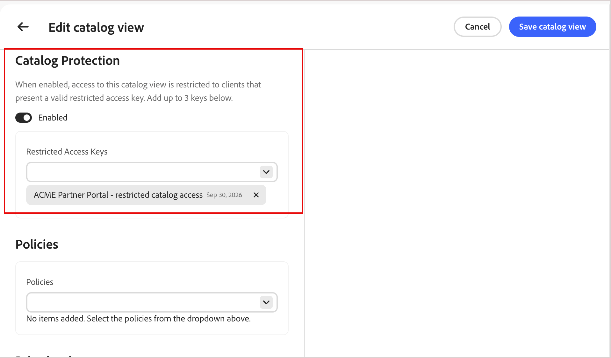

# Private catalog views

By default, a [catalog view](catalog-view.md) is public. Restrict access to a catalog view so only requests with a valid signed token can retrieve its data.

A catalog view becomes private in one of two ways:

- **Automatically, for B2B shared catalogs**—For Adobe Commerce B2B deployments that use Merchandising Services with the composable catalog data model (CCDM), private catalog views are created and configured for you automatically, based on the shared catalog configuration in [!DNL Adobe Commerce]. See [Automatic private catalog views for B2B shared catalogs](#automatic-private-catalog-views-for-b2b-shared-catalogs).

- **Manually, for any catalog view**—To restrict access to a B2C catalog view that would otherwise be public, follow the steps in [Protect a catalog view](#protect-a-catalog-view). See [Restricted access key use cases](restricted-access-keys.md#restricted-access-key-use-cases) for examples, such as partner portals and pre-release previews.

Catalog protection applies to the selected catalog view only. It does not change the view's policies or layers. It does restrict the view to a single price book—see [Price book restriction on private catalog views](#price-book-restriction-on-private-catalog-views).

## Understand the protection boundary

Catalog protection applies only to the catalog view where it is enabled. It protects catalog and search requests but does not change the view's policies or layers, protect other catalog views, or secure cart, checkout, or order operations.

The connected commerce backend must independently enforce purchase eligibility.

## Price book restriction on private catalog views

A private catalog view can reference only one price book. This differs from a public catalog view, which can use multiple price books.

When [!UICONTROL Catalog Protection] is enabled, the price book selector on the catalog view form switches from a multi-select control to a single-select (radio button) control.


- If you enable [!UICONTROL Catalog Protection] on a catalog view that has multiple price books assigned, you cannot save the view until you remove all but one price book.
- If you previously saved a private catalog view with multiple price book assignments before this restriction existed, the catalog view configuration is not automatically changed. However, the next time you edit the view, you must remove all but one price book before you can save the updates.

In each of these cases, the system displays the following validation message: `A protected catalog view can use only one price book. Select 'Single price book only' to continue.`

Public catalog views are unaffected by this restriction and can continue to reference multiple price books.

## Automatic private catalog views for B2B shared catalogs

[!BADGE Private Beta]{type=Caution tooltip="Requires the Adobe Commerce Optimizer Connector B2B extension, which is currently in private beta."}

For Adobe Commerce B2B deployments that use Merchandising Services with CCDM, the system creates and configures private catalog views automatically, based on the shared catalog configuration in [!DNL Adobe Commerce]. This configuration includes the catalog view, policy, an initial restricted access key, and a price book reference. With this configuration, you manage restricted access keys from the Commerce Admin **Restricted Access Keys** page (**System** > **Data Transfer**).

If you are not using B2B shared catalogs—for example, to protect a catalog view for a partner portal or pre-release preview, use the instructions in [Protect a catalog view](#protect-a-catalog-view) to configure one manually.

## Protect a catalog view

>[!NOTE]
>
>Skip this procedure for catalog views associated with B2B shared catalogs managed by the [!DNL Adobe Commerce Optimizer Connector for B2B]. See [Automatic private catalog views for B2B shared catalogs](#automatic-private-catalog-views-for-b2b-shared-catalogs).

Before you begin, [create a restricted access key](restricted-access-keys.md) from the public key your client application generates.

1. On the catalog view create or edit form, toggle **[!UICONTROL Catalog Protection]** to **[!UICONTROL Enabled]**.

1. Under **[!UICONTROL Restricted Access Keys]**, select up to three [restricted access keys](restricted-access-keys.md) to assign to this catalog view.

   {width="70%" zoomable="yes"}

1. Click **[!UICONTROL Save catalog view]**.

   The catalog view is now protected. Only requests carrying a valid signed token from an assigned key can retrieve its data.

   >[!NOTE]
   >
   >Allow up to five minutes for Catalog Protection configuration changes to take effect.

## Verify access is enforced

To confirm that a private catalog view rejects unauthorized requests, call its GraphQL endpoint with and without a signed token, using these headers:

| Header | Purpose |
| --- | --- |
| `AC-View-ID` | The catalog view to query. |
| `AC-Price-Book-ID` | The price book to apply. |
| `AC-Catalog-View-Access-Token` | The signed JWT proving authorization for the catalog view. |

A request without a valid token returns a GraphQL error instead of catalog data, for example:

```json
{
  "errors": [
    {
      "message": "Access key validation failed: Missing token",
      "extensions": { "x-commerce-exception": "access-key-invalid" }
    }
  ]
}
```

A request carrying a token signed by an assigned, unexpired key returns the catalog data as expected. For details on signing a JWT and calling the Merchandising API, see the [developer documentation](https://developer.adobe.com/commerce/services/optimizer/merchandising-services/using-the-api#authentication).

## Manage restricted access keys

If [!UICONTROL Catalog Protection] is enabled and all assigned keys expire, the catalog view becomes inaccessible. Storefronts that rely on this catalog view cannot serve data from it. Assign a new, unexpired key to restore access. For instructions, see [Rotate a key](restricted-access-keys.md#rotate-a-key).

>[!NOTE]
>
>For Adobe Commerce B2B deployments using Merchandising Services with CCDM, you manage access keys from the Commerce Admin **Restricted Access Keys** page (**System** > **Data Transfer**). For details, see [Restricted access key management](https://experienceleague.adobe.com/en/docs/commerce-admin/systems/data-transfer/data-sync/catalog-view-sync/restricted-access-keys) in the *[!DNL Adobe Commerce Optimizer Connector] Integration Guide*.

## More like this

- [Catalog views](catalog-view.md)—Learn how catalog views organize your product catalog by business structure, policies, and pricing.
- [Restricted access keys](restricted-access-keys.md)—Create, assign, and rotate the keys used to sign tokens for Catalog Protection.
