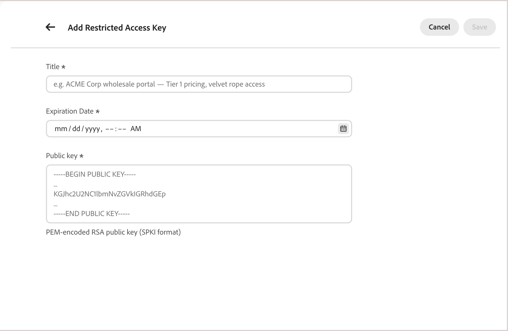

# Restricted access keys

Restricted access keys let authorized client applications access a [private catalog view](private-catalog-view.md)—only requests carrying a valid signed token from an assigned key can retrieve catalog data. All other requests are denied, including those from shoppers who do not have explicit access to this catalog view, and scripts probing the Adobe Commerce Merchandising Services API.

Restricted access keys are provisioned in one of two ways:

- **Automatically, for B2B shared catalogs**—The system provisions and assigns the initial key for catalog views that are associated with a B2B shared catalog. Then, you manage keys and key assignment from the Commerce Admin. See [Catalog view authentication](https://experienceleague.adobe.com/en/docs/commerce-admin/b2b/shared-catalogs/catalog-views-manage) in the *Commerce Admin Guide*. Automatic provisioning is available in the following deployments:

  - **Adobe Commerce as a Cloud Service with CCDM** for Adobe Commerce B2B.
  - **Adobe Commerce on cloud or on-premises** integrated with Adobe Commerce Optimizer through the [!DNL Adobe Commerce Optimizer Connector for B2B]. The B2B extension for the connector is required.

- **Manually, for any catalog view**—To protect a catalog view yourself—for example, for a partner portal or pre-release preview—follow the steps in this topic starting with [Create a restricted access key](#create-a-restricted-access-key).

## Restricted access key use cases

**[!UICONTROL Price Book ID]** determines which prices a request sees—it scopes pricing, not who can make the request. Any client that knows a catalog view's ID and price book ID can retrieve that data through the Merchandising ServicesAPI. Restricted access keys add a separate, complementary control: they scope who can access a catalog view at all, independent of which price book applies.

Restricted access keys are commonly used for:

- **Contract-based B2B pricing**—Restrict a catalog view linked to a negotiated price book so only the buyer it applies to can query it. Other buying organizations and the public cannot. For B2B shared catalogs, this is set up automatically. See [Key management and rotation](#key-management-and-rotation).
- **Partner and reseller portals**—Limit a subset of the catalog to approved partners integrating directly with the Merchandising Services API.
- **Pre-release previews**—Let a trusted internal or partner system preview upcoming products before they're publicly visible.

## How restricted access keys work

A restricted access key is the public component of an RSA key pair. Your client application generates and uses this key to prove it is authorized to read a private catalog view. In this context, _client application_ refers to the backend system that authenticates shoppers—for example, custom logic on [!DNL Adobe Commerce] or a third-party backend—never the storefront frontend itself.

The following steps describe how a key pair and signed token move from creation to validation for catalog views that aren't part of a B2B shared catalog.

1. Your client application generates an RSA key pair and keeps the private key.
1. You register the **public** key in the system as a restricted access key.
1. Your client application signs a JSON Web Token (JWT) with the private key and includes it with each request to a private catalog view.

   The system validates the token's signature against the registered public key and, if valid, returns the requested catalog data.

## Access the restricted access key workspace

How you open the restricted access keys workspace depends on the product you use:

- **Adobe Commerce Admin** (Adobe Commerce as a Cloud Service)—Select *System* > *Data Transfer* > **Restricted Access Keys**.
- **Adobe Commerce Optimizer Studio**—Select *Store setup* > **Restricted access keys**.

## Create a restricted access key

>[!NOTE]
>
>This section and the two that follow describe the manual process to manage restricted access keys. For B2B shared catalogs with automatic key provisioning, manage keys from the Commerce Admin. See [Restricted Access Keys](https://experienceleague.adobe.com/en/docs/commerce-admin/systems/data-transfer/data-sync/catalog-view-sync/restricted-access-keys).

### Add a restricted access key

Select the tab for the tool you use to manage keys: Commerce Admin or Adobe Commerce Optimizer Studio.

>[!BEGINTABS]

>[!TAB "Adobe Commerce Admin"]

Customers using Adobe Commerce as a Cloud Service with CCDM, or Adobe Commerce Optimizer connected to Adobe Commerce through the connector, can generate RSA key pairs from the Commerce Admin. See [Manage restricted access keys](https://experienceleague.adobe.com/en/docs/commerce-admin/systems/data-transfer/data-sync/catalog-view-sync/restricted-access-keys).

>[!TAB "Adobe Commerce Optimizer Studio (manual key management)"]

Customers using Adobe Commerce Optimizer Studio must generate and manage their own RSA key pairs, and then add the public key to the system. This is the required workflow for Adobe Commerce Optimizer with a third-party backend. Customers who use the connector can also use this workflow instead of the Commerce Admin.

**Generate an RSA key pair**

For initial testing of private catalog views, generate a key pair using a tool such as [!DNL OpenSSL]. Keep the private key secret. Only the public key is uploaded to the system as a restricted access key.

```bash
openssl genrsa -out private-key.pem 2048
openssl rsa -in private-key.pem -pubout -out public-key.pem
```

The key size must be between 2048 and 8192 bits. `public-key.pem` contains the value you paste into the **[!UICONTROL Public key]** field below.

**Add the public key to the system**

1. From the Restricted Access key workspace, click **[!UICONTROL Add Restricted Access Key]**.

   {width="70%" zoomable="yes"}

1. Enter the key details:

    {width="70%" zoomable="yes"}

    - **[!UICONTROL Title]**—A label to identify the key, shown in the key list and the catalog view key picker, for example `ACME Corp wholesale portal — Tier 1 pricing`.
    - **[!UICONTROL Expiration date]**—Date and time (UTC) after which the key stops being honored, even for a token that hasn't expired yet.
    - **[!UICONTROL Public key]**—The PEM-encoded RSA public key in Subject Public Key Info (SPKI) format, including the `-----BEGIN PUBLIC KEY-----` and `-----END PUBLIC KEY-----` markers. Must be unique across the environment.

1. Click **[!UICONTROL Save]**.

>[!ENDTABS]

Keys are immutable after creation. To change any value, delete the key and create a new one. See [Rotate a key](#rotate-a-key) to do this without an access interruption.

## Assign a key to a catalog view

A restricted access key only authenticates access after it is assigned to a catalog view with **[!UICONTROL Catalog Protection]** enabled. See [Protect a catalog view](private-catalog-view.md#protect-a-catalog-view) for setup steps.

## Delete a key

1. In the **[!UICONTROL Restricted access keys]** workspace, find the key you want to remove and delete it.

   If the key is assigned to one or more catalog views, a warning explains that client applications relying on that key lose access. The catalog views themselves remain protected—they don't become publicly accessible.

1. Confirm the deletion.

## Key management and rotation

Restricted access keys are managed in one of two ways, depending on how you use catalog protection:

- **Automatically, for B2B shared catalogs**—For Adobe Commerce B2B deployments using Merchandising Services with CCDM, and for Adobe Commerce Optimizer deployments integrated through the [!DNL Adobe Commerce Optimizer Connector for B2B] (which requires the B2B extension), the service automatically generates and assigns the first restricted access key when a catalog view is created. Each catalog view gets its own key. After that, you can manage each key from the Shared Catalog or Company Account pages. You can also view and manage keys from the Commerce Admin **Restricted Access Keys** page (**System** > **Data Transfer**). See [Manage catalog view configuration](https://experienceleague.adobe.com/en/docs/commerce-admin/b2b/shared-catalogs/catalog-views-manage).

  Each combination of a shared catalog and a store view is projected as a separate catalog view. A projection is the catalog view, policy, price book reference, and restricted access key configuration data that is exported to the Merchandising Services data layer for that combination. So a shared catalog assigned to multiple store views produces multiple catalog views, each with its own key. Edit or rotate a key for one catalog view without affecting the others.

  Keys default to a long expiration period. If you need to rotate a key, add the replacement in the Admin and keep both active until you remove the old one.

- **Manually, for any catalog view**—How you generate and manage keys depends on your product context. In either case, the backend client that authenticates shoppers signs the tokens.

  - **Commerce Admin (Adobe Commerce as a Cloud Service with CCDM, or Adobe Commerce Optimizer with the connector)**—Generate RSA key pairs in the Commerce Admin, and create, assign, and delete keys on the **Restricted Access Keys** page. Adobe Commerce does not rotate keys automatically. To rotate a key, see [Rotate a key](#rotate-a-key).
  - **Adobe Commerce Optimizer Studio**—Studio does not generate keys. This is the required workflow for Adobe Commerce Optimizer with a third-party backend, and connector customers can also use it. Use your client application to generate the RSA key pair, keep the private key, and add the public key as a restricted access key. Use the steps earlier in this topic to create, add, and delete keys. To rotate a key, see [Rotate a key](#rotate-a-key).

### Rotate a key

To rotate a key without an access interruption, note that a catalog view can have up to three keys assigned at once:

Select the tab for the tool you use to manage keys: Commerce Admin or Adobe Commerce Optimizer Studio.

>[!BEGINTABS]

>[!TAB "Adobe Commerce Admin"]

See [Key selection and rotation](https://experienceleague.adobe.com/en/docs/commerce-admin/systems/data-transfer/data-sync/catalog-view-sync/restricted-access-keys#key-selection-and-rotation). This applies to Adobe Commerce as a Cloud Service with CCDM and to Adobe Commerce projects integrated with Adobe Commerce Optimizer through the Adobe Commerce Optimizer connector.

>[!TAB "Adobe Commerce Optimizer Studio (manual key management)"]

This procedure is required for Adobe Commerce Optimizer with a third-party backend. Customers who use the connector can also use it instead of the Commerce Admin.

1. Generate a new key pair and add the new public key as a new restricted access key.
1. Assign the new key to the catalog view alongside the existing key.
1. Start signing new tokens with the new private key to complete the key rollover.
1. Once all client applications are confirmed on the new key, remove and delete the old key.

>[!ENDTABS]

## Limits

See [Catalog views and policy limits](https://experienceleague.adobe.com/en/docs/commerce/optimizer/boundaries-limits).

## More like this

- [Private catalog views](private-catalog-view.md)—Learn how to protect a catalog view with restricted access keys.

