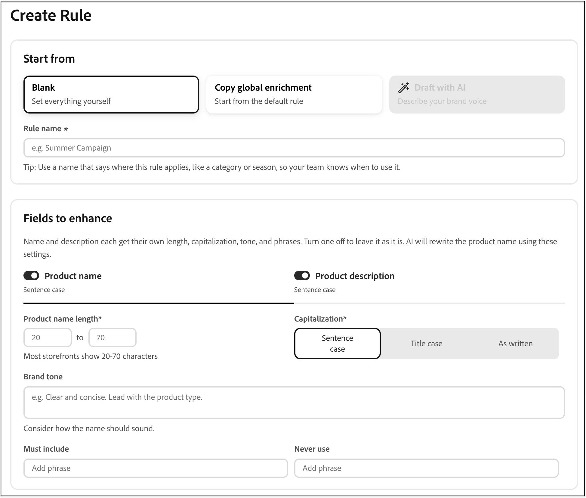

# Create Catalog Enrichment brand rules

Brand governance and brand governance rules are available only for Catalog Enrichment. They do not apply to PDP enrichment. These rules define requirements for product names and descriptions generated by [!DNL Commerce Catalog Agent]. Edit or configure a Default Rule for your default brand standards, then create custom rules for specific campaigns, product categories, or sub-brands. Select a rule when you create a [Catalog Enrichment](catalog-enrichment.md) job.

## Open brand governance

1. In the Admin, go to **[!UICONTROL AI Product Discovery]** > **[!UICONTROL Catalog Enrichment]**.
1. Open the **[!UICONTROL Brand Governance]** tab.

The **Brand Governance** tab contains the Default Rule and any custom rules you have created. You can search for rules or filter the table of rules.

For each row, you see the **Rule name**, **Fields**, **Tone**, **Last modified**, and **Status**. The Default Rule is marked **[!UICONTROL Default]**.

The **[!UICONTROL Needs your attention]** area highlights rules that need work, such as drafts that need setup or rules with conflicts. Review the rule details and use the available action, such as **[!UICONTROL Finish setup]** or **[!UICONTROL Fix conflict]**.

## Understand rule types

Catalog Enrichment supports a default rule and custom rules.

### Default Rule

Each [!DNL Adobe Commerce] instance has exactly one Default Rule. [!DNL Adobe Commerce] creates this rule with empty fields. Its name is fixed as **[!UICONTROL Global]**. You can edit the rule, but you cannot delete it.

[!DNL Adobe Commerce] applies the Default Rule by default when you create a Catalog Enrichment job without selecting a custom rule. The Default Rule provides the baseline governance for Catalog Enrichment.

### Custom rules

You can create any number of custom rules for a campaign, product category, or sub-brand. A custom rule is not applied automatically. Select it when creating a Catalog Enrichment job.

A custom rule does not inherit values from the Default Rule. When you create a custom rule, you can copy the Default Rule's current values as a one-time starting point. Later changes to the Default Rule do not update the custom rule.

Use the Default Rule for standards that should apply when a user does not select a custom rule. Create a custom rule for a campaign or category with different requirements. Add any Global requirements that the custom rule also needs, because custom rules do not inherit Global values.

## Create a custom rule

In this section, you learn how to create a brand governance rule.

1. In the **Brand Governance** tab, click **[!UICONTROL Create Rule]**.
1. Choose how to start the rule:
   - **[!UICONTROL Blank]**: Set all values yourself.
   - **[!UICONTROL Copy Global enrichment]**: Start with the current Default Rule values as a one-time copy.
   - **[!UICONTROL Draft with AI]**: (**Coming soon**) Describe your brand voice to get suggested rule values.
1. Enter a **Rule name** that identifies its purpose, such as a campaign, category, or sub-brand.
1. Under **Fields to enhance**, configure the product name and product description requirements.

   Configure product names and descriptions separately. Each field has its own enable switch and governance requirements.

1. Set **Product name length**.

   Set the minimum and maximum name length range for an enriched product name. For example, a rule can require a minimum of 20 characters and a maximum of 200 characters.

1. Set the **Capitalization** option:

   - **[!UICONTROL Sentence case]**: `Waterproof hiking boots`
   - **[!UICONTROL Title Case]**: `Waterproof Hiking Boots`
   - **[!UICONTROL As written]**: Preserve the capitalization of the source text.

1. Describe the **Brand tone**. See [set brand tone](#set-brand-tone) for guidance.
1. Set the required and excluded phrases

   Add a **[!UICONTROL Must include]** phrase.
   Add a **[!UICONTROL Never use]** phrase.

1. Click **[!UICONTROL Save as draft]** to finish later, or click **[!UICONTROL Publish rule]** to make the rule available for selection when creating a catalog enrichment rule. Click **[!UICONTROL Cancel]** to leave without saving.

1. You can now apply the rule to a [Catalog enrichment](catalog-enrichment.md) job.

### Set brand tone

Enter guidance in the multiline **[!UICONTROL Brand tone]** field to describe the voice and style of the enriched name.

Here are some examples of the tone you might use for the **Description**:

- **B2B industrial**: `Write for the operator and the buyer. Open with what the unit does and where it fits in the kitchen, then throughput, utility requirements, footprint, and certifications. Plain, technical language. Mention cleaning and maintenance, because total cost of ownership drives the decision. No lifestyle language.`
- **Luxury fashion**: `Quiet confidence. Lead with craftsmanship and provenance (atelier, tannery, technique), then how the piece wears and ages. Short, measured sentences. Sensory detail is fine. Never compare to other brands or mention price or value.`
- **Consumer electronics**: `Clear and benefit-led. Turn every spec into what it does for the user. Scannable short paragraphs or bullets. Put compatibility and what's in the box up front. Don't make performance claims without a source, and don't use comparative claims like "fastest"`
- **Specialty food and grocery**: `Warm and appetizing, but honest. Describe taste, texture, and aroma in concrete terms, then origin and how it's made, then serving ideas. Plain, friendly language. Put allergens and dietary attributes in a consistent closing line. Don't make health claims.`
- **Home furnishings**: `Inviting and practical. Open with how the piece is used, then dimensions, materials, and care. Help the shopper picture it in their space without overselling. Always mention assembly, delivery, and weight, since those drive returns.`
