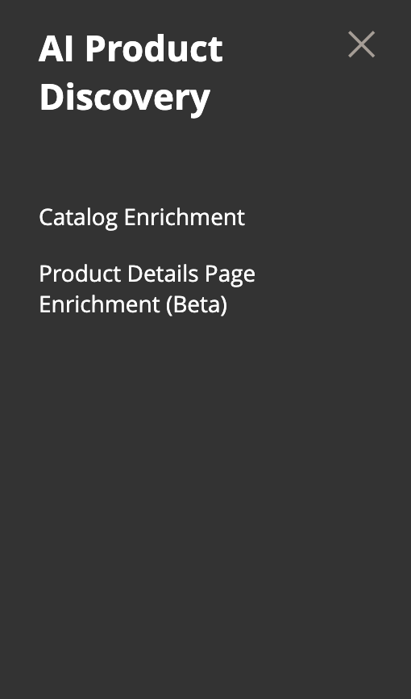

# AI product discovery

Product discovery is how shoppers find and evaluate products that meet their needs. In conversational AI tools such as [!DNL ChatGPT] and [!DNL Gemini], shoppers can describe what they want in everyday language and use AI-generated responses to explore and compare products. The usefulness of those responses depends in part on whether AI agents can access and interpret relevant product data.

## Why product discovery matters

Shoppers often describe a need, use, or preference rather than search for an exact product name or technical attribute. To match those requests with relevant products, AI agents need product information that is both structured and meaningful to shoppers.

When product records are incomplete, inconsistent, or focused only on technical specifications, agents may have difficulty understanding which products fit a shopper's intent. Shoppers can miss relevant products, and merchants may need to spend time correcting and enriching catalog content manually.

Additionally, unbranded shopper queries create new opportunities for product discovery. When shoppers describe their needs without specifying a brand, AI surfaces show relevant products across competing brands based on how well those products match shopper intent. For merchants, this creates an opportunity to reach new customers who may not be familiar with their brand, expanding product visibility beyond existing brand awareness.

## Challenges in product discovery on AI surfaces

Two common catalog gaps can limit AI-assisted product discovery:

### Product facts are difficult to access and interpret

Product information is often distributed across attributes, variants, options, categories, and other catalog fields. While this information may be available to shoppers on the storefront, it is not always accessible or easily interpreted by AI crawlers. Product details presented through dynamically rendered content, JavaScript-dependent components, interactive shopping wizards, pop-ups, or linked pages may be difficult for crawlers to retrieve.

Even when this information is accessible, it may not be structured in a way that AI agents can reliably interpret. As a result, AI agents may lack a complete understanding of a product's features, available options, and capabilities, limiting their ability to accurately match products to shopper needs.

### Product catalog does not reflect shopper intent

Shoppers increasingly describe their needs, problems, and intended use cases in natural language rather than searching for specific product names or technical specifications. However, product names and descriptions often focus on technical attributes without clearly communicating the benefits, use cases, or real-world problems a product addresses.

This creates a gap between how shoppers express their needs and how products are described in the catalog. Without clear, shopper-focused product content, AI agents may struggle to interpret a product's value and relevance to a shopper's intent, potentially overlooking suitable products in favor of alternatives whose descriptions more clearly align with the shopper's needs.

## Enrichment workflows for product discovery

[!DNL Adobe Commerce] provides two complementary enrichment workflows to improve how AI agents access, understand, and match products to shopper intent.

These two enrichments are accessible in the _Admin_ > **AI Product Discovery** menu.



### Make structured facts available with Product Detail Page Enrichment

PDP Enrichment creates a structured data payload containing relevant product information, including attributes, variants, options, feature bullets, category relationships, pricing, and availability. This provides AI agents with a more complete and structured understanding of a product's features, capabilities, and available configurations.

Using [Optimize at Edge](#prerequisites) technology, the enriched product information is made directly accessible to AI crawlers without requiring changes to the human-visible storefront. Merchants can improve how product information is presented to AI agents without modifying storefront layouts, introducing new shopper-facing components, or requiring custom storefront development.

See [product detail page enrichment](pdp-enrichment.md).

### Optimize product catalog content with shopper intent using Catalog Enrichment

Catalog Enrichment transforms technical product attributes and existing catalog information into shopper-focused product names and descriptions that clearly communicate a product's benefits, capabilities, and real-world use cases. Product names and descriptions are among the most influential sources of information AI surfaces use to understand product capabilities and determine their relevance to shopper intent. 

By connecting technical product specifications to the needs and problems shoppers describe in natural language, Catalog Enrichment helps AI agents better understand a product's value, reduce ambiguity in interpreting its capabilities, and more accurately match relevant products to shopper intent.

Merchants can review and approve suggested improvements before applying them directly to their Adobe Commerce product catalog. This ensures that storefronts and sales channels powered by the catalog can consistently communicate the same enriched, value-driven product information to shoppers across touchpoints.

See [Catalog enrichment](catalog-enrichment.md).

#### Brand governance rules

Brand governance rules let you define product copy requirements for catalog enrichment, including length, phrases, tone, and capitalization. These rules apply only to catalog enrichment, not PDP enrichment.

See [Create Catalog Enrichment brand rules](brand-governance.md).

## Choose an enrichment workflow

Use Catalog enrichment to improve product names and descriptions for discovery. Use PDP enrichment to maximize crawlability for LLMs with structured product data without making any changes to your human visible experience. These workflows address different data gaps and remain separate.

## Who this guide is for {#who-this-guide-is-for}

- Digital marketers and merchandisers who want product data to be accurate and useful in AI-assisted product discovery.
- Merchandisers who need a controlled way to enrich selected products or prepare copy for a campaign.
- [!DNL Adobe Commerce] administrators responsible for catalog data, services, and Admin access.

## Prerequisites {#prerequisites}

Prerequisites depend on your deployment type and the enrichment workflow you plan to use.

### [!DNL Adobe Commerce] on Cloud or on-premises

- **IMS organization and sign-in:** An [!DNL Adobe IMS] organization must be available. If your organization does not have one, follow the [Adobe IMS integration overview](https://experienceleague.adobe.com/en/docs/commerce-admin/start/admin/ims/adobe-ims-integration-overview). Catalog Enrichment uses the signed-in Admin user's IMS access token; a native Commerce username and password alone do not provide this token.
- **Optimize at Edge:** Required for PDP enrichment, but not for Catalog enrichment. The [Optimize at Edge guide](https://experienceleague.adobe.com/en/docs/brand-visibility/using/resources/optimize-at-edge/fastly-byocdn) is a reference, not a Commerce setup guide.
- **Log forwarding:** Optional. Configure log forwarding to enable agentic traffic-based recommendations for both workflows. Without it, you can still select PDPs or SKUs manually for enrichment.

<!--
TBD: Commerce-specific setup instructions are needed. This might be automated by GA.
-->

#### Install Catalog Service {#install-catalog-service}

The shared enrichment extension requires Catalog Service. Catalog Service is installed automatically when you enable [!DNL Live Search] or [!DNL Product Recommendations]. If neither service is enabled, install Catalog Service before the shared enrichment extension.

You need command-line access to the Commerce application server and permission to download packages from `repo.magento.com`. Catalog Service requires Adobe Commerce 2.4.4 or later.

From your Commerce project directory, add and update the Catalog Service package:

```bash
composer require magento/catalog-service --no-update
composer update magento/catalog-service
```

For Adobe Commerce on cloud infrastructure, commit and push the changes to `composer.json` and `composer.lock` to deploy the package.

For Adobe Commerce on-premises, upgrade the application and clear the cache:

```bash
bin/magento setup:upgrade
bin/magento cache:clean
```

Configure the Commerce Services Connector with API keys and a SaaS Data Space if it is not already configured for another Commerce service.

#### Install the shared enrichment extension {#install-enrichment-extension}

Install the Catalog Enrichment extension once to enable both Catalog Enrichment and PDP Enrichment:

```bash
composer require magento/module-catalog-enrichment --no-update
composer update magento/module-catalog-enrichment
```

For Adobe Commerce on-premises, upgrade the application and clear the cache:

```bash
bin/magento setup:upgrade
bin/magento cache:clean
```

#### Monitor and troubleshoot data synchronization {#monitor-enrichment-data-sync}

After you deploy the extensions, confirm that Commerce exports catalog data and that Catalog Service receives it. The Data Feed Sync Status page reports export status; the Data Management Dashboard confirms downstream availability.

1. In the Admin, go to **[!UICONTROL System]** > **[!UICONTROL Data Transfer]** > **[!UICONTROL Data Feed Sync Status]**.
1. Review the product feeds and confirm that successfully sent records match the source records, with no failed or awaiting submissions.
1. For failed records, review the error details, resolve the issue, and schedule a resync for the affected records.
1. Go to **[!UICONTROL System]** > **[!UICONTROL Data Transfer]** > **[!UICONTROL Data Management Dashboard]** and confirm that the expected catalog data is available in Catalog Service.

For status details and additional troubleshooting steps, see [Monitor data feed status](/help/systems/data-feed-sync-status.md#monitor-data-feed-status).

#### Additional Catalog Enrichment requirements

- Enable and maintain the required Commerce services and catalog connectivity. See [Configure catalog enrichment](settings.md).
- Make the storefront accessible to relevant LLM-oriented and agentic bots when you need crawl-based catalog recommendations.
- Have access to the Adobe Admin Console. During setup, [!DNL Adobe Commerce] checks whether your organization has signed the GenAI rider or opted out for the underlying AI services.

### [!DNL Adobe Commerce as a Cloud Service]

- **Optimize at Edge:** Required for PDP enrichment, but not for Catalog enrichment. See [Optimize at Edge guide](https://experienceleague.adobe.com/en/docs/brand-visibility/using/resources/optimize-at-edge/fastly-byocdn) for more information.
- **Log forwarding:** Optional. Configure log forwarding to enable agentic traffic-based recommendations for PDP enrichment and Catalog enrichment. Without it, you can still select PDPs or SKUs manually for enrichment.
