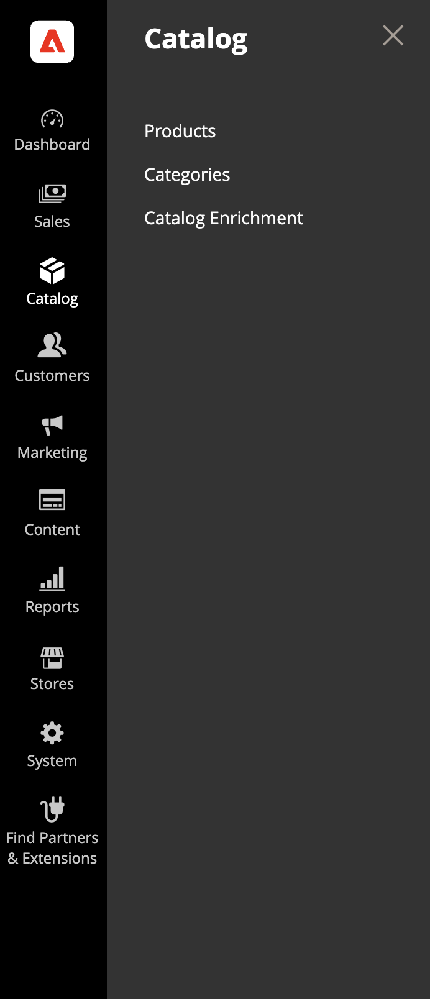
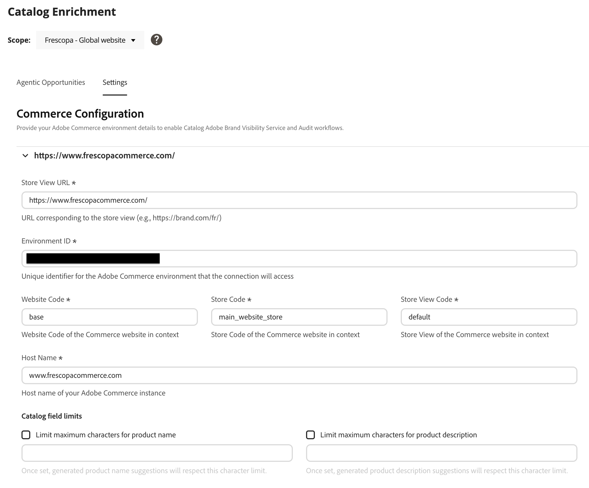
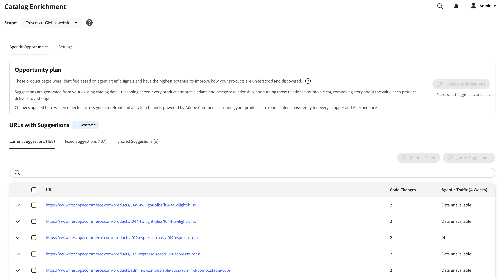
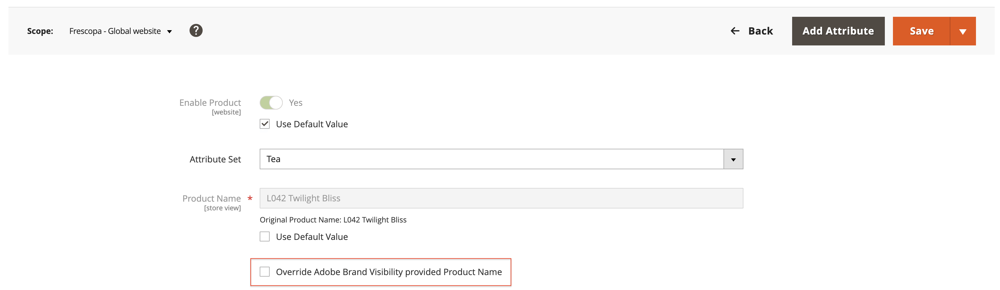
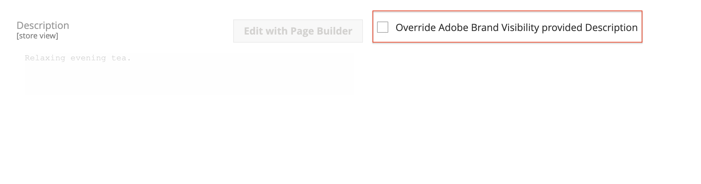

# Catalog enrichment

Catalog enrichment is a native [!DNL Adobe Commerce] capability that helps you improve product names and long descriptions so that your catalog is represented more accurately when shoppers use LLMs and AI assistants for product research and discovery.

>[!NOTE]
>
>Catalog enrichment is powered by [!DNL Commerce Catalog Agent] and [!DNL Adobe Brand Visibility] behind the scenes. You use enrichment as part of your Commerce catalog workflow. You do not manage a separate Adobe Brand Visibility integration to apply approved name and description updates. For broader LLM monitoring and optimization outside Commerce, see the [[!DNL Adobe Brand Visibility] product documentation](https://experienceleague.adobe.com/en/docs/brand-visibility/using/home).

## How it works {#how-it-works}

Your [!DNL Adobe Commerce] product catalog is the system of record for product data: names, descriptions, attributes, pricing, and inventory. [!DNL Adobe Commerce] Storefront MCP (Model Context Protocol) connects live catalog data to Adobe AI experiences. From there, the Catalog Agent can identify gaps in product names and long descriptions, propose improvements, and write approved changes back to Commerce so you can review them in the Commerce Admin.

With catalog enrichment, you can:

- Identify gaps and inconsistencies in product names and long descriptions that affect how LLMs interpret your products.
- Review suggested improvements with supporting context, including justifications and before-and-after comparisons.
- Apply approved updates directly to the Commerce catalog so the Admin, storefront, and other channels that read those fields stay aligned.

Because product names and long descriptions live in Commerce, improving copy once can benefit every channel that consumes that product data. The benefit depends on how and when your systems refresh.

| Direction | Purpose |
| --- | --- |
| Commerce catalog -> analysis | Catalog and URL signals feed enrichment suggestions. |
| Enrichment -> Commerce catalog | After you approve an update, changes to product name and description are saved to the Commerce catalog so the Admin and storefront reflect the optimized values. |

## Who this is for {#who-this-is-for}

- Digital marketers and merchandisers who want product data to be accurate and consistent in LLM-driven answers.
- Digital marketers and merchandisers who need a controlled way to improve catalog copy at scale.
- Commerce administrators who own catalog integrity, Admin processes, and integrations (API, CSV, PIM) that feed product attributes.

## Prerequisites {#prerequisites}

The following prerequisites apply when you have access to catalog enrichment.

- Your storefront can be crawled by LLM-oriented and agentic bots where crawl coverage is required for catalog-aware suggestions.
- Required Commerce services and catalog connectivity are enabled and healthy. See [Enable catalog enrichment](#enable-catalog-enrichment) to learn more.
- The Commerce Admin user who accesses catalog enrichment signs in through Adobe IMS. See [IMS sign-in and organization requirements](#ims-sign-in-requirements).
- You have access to the [Adobe Admin Console](https://helpx.adobe.com/business/enterprise/plan-your-deployment/basic-concepts/admin-console.html).
- Your organization has signed the GenAI rider, or explicitly opted out, for the underlying AI services.

>[!NOTE]
>
>As part of setup, Commerce checks whether your organization has signed the GenAI rider that covers the AI services behind catalog enrichment. If you have not yet signed the rider or opted out, you are prompted to sign or update the rider before you can use catalog enrichment.

### IMS sign-in and organization requirements {#ims-sign-in-requirements}

Catalog enrichment uses the signed-in Commerce Admin user's Adobe IMS access token to connect to [!DNL Adobe Brand Visibility]. A native Commerce Admin sign-in with only a Commerce user name and password does not produce this token, so the Admin user who accesses catalog enrichment must sign in through Adobe IMS.

To support IMS sign-in, your Commerce instance must have the Commerce Admin Integration with Adobe ID enabled. See [Configure the Commerce Admin Integration with Adobe ID](/help/getting-started/adobe-ims-config.md).

>[!IMPORTANT]
>
>Enabling the Commerce Admin Integration with Adobe ID is an instance-wide change. Once enabled, every Admin user must authenticate through Adobe IMS, and native Commerce username-and-password sign-in is no longer available. Review [Adobe Identity Management Service (IMS) integration overview](/help/getting-started/adobe-ims-integration-overview.md) before you enable this integration.

The Adobe IMS organization associated with your Commerce instance is typically different from the IMS organization that holds your [!DNL Adobe Brand Visibility] entitlement. Enabling the Commerce Admin Integration with Adobe ID does not, by itself, grant access to the Brand Visibility entitlement, and the two organizations are not required to be the same. Work with your Adobe administrator or account team to confirm which IMS organization memberships and account access catalog enrichment requires in your setup.

## Enable catalog enrichment {#enable-catalog-enrichment}

Work with your Commerce administrator or implementation partner to ensure the following before you review or apply suggestions:

### Install catalog enrichment and catalog services extensions

1. Install the catalog enrichment extension in your Commerce instance and apply the changes:

    ```bash
    composer require magento/module-catalog-enrichment:^2.1
    bin/magento setup:upgrade
    bin/magento cache:flush
    ```

    `setup:upgrade` enables the extension, creates its database table, and grants the Admin permissions. Flush the cache afterward so the permissions take effect. In production mode, also run `bin/magento setup:di:compile` and `bin/magento setup:static-content:deploy`.

1. If you have not already installed Catalog services, [do so](https://experienceleague.adobe.com/en/docs/commerce/catalog-service/installation#install-the-catalog-service-extension).

    **[!UICONTROL Catalog enrichment]** is now available in your Commerce instance.

>[!IMPORTANT]
>
>Catalog enrichment 2.1.2 and later requires Adobe Commerce 2.4.7 or later on PHP 8.3 or later, and cannot be installed together with the [!DNL Adobe Brand Visibility] extension (`magento/llm-optimizer`). If you have it installed, remove it before you upgrade. See [Upgrade from earlier versions](#upgrade-from-earlier-versions) in the release notes.

### Access catalog enrichment

After you install the catalog enrichment and catalog services extensions, the catalog enrichment capability is available in the Admin under **[!UICONTROL AI Product Discovery]** > **[!UICONTROL Catalog Enrichment]**.

{zoomable="yes"}

>[!NOTE]
>
>The **[!UICONTROL AI Product Discovery]** menu also lists **[!UICONTROL Product Details Page Enrichment (Beta)]**. Product details page enrichment is in beta and is not yet generally available.

### Configure catalog enrichment {#configure-catalog-enrichment}

Configure catalog enrichment on the **[!UICONTROL Settings]** tab so [!DNL Commerce Catalog Agent] can connect to your [!DNL Adobe Commerce] environment and surface suggestions in the Commerce Admin.

The fields on this tab identify the Commerce environment and store view that catalog enrichment connects to. They are separate from the Adobe IMS organization that holds your [!DNL Adobe Brand Visibility] entitlement. See [IMS sign-in and organization requirements](#ims-sign-in-requirements).

1. In the Admin, go to **[!UICONTROL AI Product Discovery]** > **[!UICONTROL Catalog Enrichment]**.
1. In the **[!UICONTROL Scope]** list at the top of the page, select the store view you want to configure, or leave **[!UICONTROL All Store Views]** to manage settings across store views.
1. Open the **[!UICONTROL Settings]** tab.
1. In **[!UICONTROL Commerce Configuration]**, expand the store view panel labeled with its URL.

   Provide your [!DNL Adobe Commerce] environment details to enable the Catalog Adobe Brand Visibility Service and audit workflows.

   {zoomable="yes"}

1. Enter the required connection details for the store view.

    - **[!UICONTROL Store View URL]**: URL corresponding to the store view (for example, `https://brand.example.com/fr/`).
    - **[!UICONTROL Environment ID]**: Unique identifier for the [!DNL Adobe Commerce] environment that the connection accesses.
    - **[!UICONTROL Website Code]**, **[!UICONTROL Store Code]**, and **[!UICONTROL Store View Code]**: Website, store, and store view codes for the Commerce website. These values must match the codes in your Commerce Admin.
    - **[!UICONTROL Host Name]**: Host name of your [!DNL Adobe Commerce] instance.

1. Click **[!UICONTROL Save]**.

After you save, wait for any initial sync or validation job to complete before relying on catalog or audit results for that store view. It may take up to 24 hours for product suggestions to appear on the **[!UICONTROL Catalog Enrichment]** page.

To remove a store view configuration, expand that entry and click **[!UICONTROL Delete]**.

#### Field descriptions {#commerce-connection-fields}

Required fields are marked with an asterisk (*) on the **[!UICONTROL Commerce Configuration]** form.

| Field | Required | Description |
| --- | --- | --- |
| Store View URL | Yes | URL corresponding to the store view (for example, `https://brand.example.com/fr/`). |
| Environment ID | Yes | Unique identifier for the [!DNL Adobe Commerce] environment that the connection accesses. |
| Website Code | Yes | Website Code of the Commerce website. |
| Store Code | Yes | Store Code of the Commerce website. |
| Store View Code | Yes | Store View of the Commerce website. |
| Host Name | Yes | Host name of your [!DNL Adobe Commerce] instance. |

### Review and apply catalog enrichment {#review-and-apply}

After catalog enrichment is enabled and configured, product suggestions display on the **[!UICONTROL Agentic Opportunities]** tab. From here, you can review suggestions and apply approved updates to product names and long descriptions in your Commerce catalog.

Catalog enrichment uses the following workflow views:

- **[!UICONTROL Current Suggestions]**: New or active items to review.
- **[!UICONTROL Fixed Suggestions]**: Items you already applied or resolved.
- **[!UICONTROL Ignored Suggestions]**: Items you intentionally excluded from action.

{zoomable="yes"}

### Deploy approved suggestions {#review-deploy-catalog}

To deploy approved suggestions:

1. Select **[!UICONTROL Current Suggestions]**.
1. Click the expand control for the URL or SKU row to show the proposed product name and product description updates.
1. Review the suggestion and confirm it matches your merchandising and SEO strategy.

  You can edit a suggestion before you deploy it or move it to **[!UICONTROL Ignored Suggestions]** if it does not match your strategy.

1. Select the row for the URL or SKU to update.
1. Click **[!UICONTROL Deploy optimizations]** and confirm.

Approved name and description changes are saved to your [!DNL Adobe Commerce] catalog like other product updates.

>[!IMPORTANT]
>
>Treat each applied update as a production catalog change. Use your normal change-control, staging, and QA practices. Apply updates only after merchandising and SEO stakeholders agree on the final copy.

After you apply an update, suggestions move to **[!UICONTROL Fixed Suggestions]** with a **Marked as Fixed** status.

## Verify enrichment in the Admin {#verify-in-admin}

**To verify applied catalog enrichment:**

1. Go to **[!UICONTROL Catalog]** > **[!UICONTROL Products]** in the Commerce Admin.
1. Use filters and the **[!UICONTROL Store View]** selector as needed (for example, **[!UICONTROL Default Store View]**).
1. Search for the SKU.
1. Open the product in edit mode.

   The product form shows the enriched product name and/or description.

   {zoomable="yes"}

1. Optional: Select **[!UICONTROL Override Catalog Agent provided Product Name]** if you want to keep a manually entered name instead.

   Manual overrides affect how suggestions stay in sync with the catalog. For more information, see [Manual override in the Admin](#manual-override-in-the-admin).

1. Expand the **[!UICONTROL Content]** section and locate the description field.

   The enriched description appears when you applied description changes.

   {zoomable="yes"}

1. Optional: Select **[!UICONTROL Override Catalog Agent provided Description]** if you want to keep a manually entered description instead.

  Manual overrides affect how suggestions stay in sync with the catalog. For more information, see [Manual override in the Admin](#manual-override-in-the-admin).

## Verify enrichment on the storefront {#verify-storefront}

**To verify enrichment on the storefront:**

1. Search for the SKU on your storefront.
1. Open the product page.
1. Confirm that the product name and description matches what you approved.

   It may take some time before enrichments appear on your storefront.

1. Confirm that regions that show the long description match what you approved.
1. Optional: Confirm downstream channels that consume the same catalog attributes, where relevant to your rollout.

## Overrides, ingestion, and outdated suggestions {#overrides-ingestion}

After catalog enrichment updates a product's name or description, other ingestion systems may change the same fields. Examples include REST API calls, CSV imports, and PIM feeds.

### Original value re-ingested {#original-value-reingested}

If an external process writes the original name or description (the value that existed before enrichment was applied), Commerce continues to honor the enriched value for that field according to the catalog enrichment rules. The suggestion may not revert automatically based on that ingestion alone.

### New value re-ingested {#new-value-reingested}

If the external process sends a new value that is not a repeat of the pre-enrichment text, Commerce honors the new catalog value. For example, a rename from "Red Shoes" to "Iconic Red Shoes" replaces the enriched value. The related enrichment suggestion is typically marked as *Outdated* because the live catalog no longer matches the suggestion context.

### Manual override in the Admin {#manual-override-in-the-admin}

If you manually edit the product name or description in the [!DNL Adobe Commerce] Admin:

- The Admin value wins as the system of record for that manual change.
- The enrichment suggestion is marked *Outdated*.
- The suggestion workflow moves back toward the original state for that item so you can re-baseline or accept a new suggestion if analysis runs again.

These rules help you know whether catalog enrichment, ingestion feeds, or Admin edits are authoritative when multiple channels touch the same SKU.

## Limits and considerations {#limits}

- Enrichment currently supports English-language product content only.
- Enrichment applies to product names and long descriptions only. It does not change PDP layout, widgets, or other page-level storefront content.
- Large catalogs and high URL counts can affect how quickly analysis completes and how many suggestions appear at once.
- Meaningful suggestions assume that LLM-relevant bots can access the product URLs you care about. Robots rules, authentication, geo-blocking, and heavy personalization can reduce coverage.

## Best practices {#best-practices}

- Document system ownership for product name and description so that PIM or feed jobs do not unintentionally conflict with catalog enrichment.
- Coordinate with SEO and brand teams before bulk applying titles or descriptions.
- Re-sync or re-analyze after major catalog imports so that suggestions reflect the current catalog state.

## Examples

The following examples show how catalog enrichment turns raw technical attributes into shopper-focused, narrative product copy that LLMs can use to answer shopping questions.

### Example: Coffee product with technical attributes

A coffee retailer's catalog stores only the technical specifications for a medium roast coffee bean product: bean variety, origin region, processing method, roast level, and altitude range. These fields describe the product but do not communicate its value to a shopper, so an AI assistant has little to work with when answering a question like "what coffee has a smooth, low-acid flavor?"

Catalog enrichment reads the technical attributes and reasons through how they interact to infer shopper-relevant characteristics:

| Technical attribute | Inferred characteristic | Reasoning |
| --- | --- | --- |
| Honey Process, Medium Roast | Low acidity | Fruit mucilage left on the bean during honey processing suppresses acidity, and the medium roast breaks down residual acidic compounds. |
| Honey Process, Arabica, Medium Roast | Hazelnut flavor | Fruit sugars from the mucilage combine with Arabica's natural nut notes, amplified at medium roast. |
| Honey Process, Arabica | Rich, creamy mouthfeel | Oils absorbed from the mucilage during drying add viscosity and body. |
| Honey Process, Altitude 900-1200m | Caramel undertones | Denser, high-altitude beans develop more complex sugars, deepened by honey processing. |

Catalog enrichment applies these inferred characteristics to the product copy:

- **Before**: "Medium Roast Coffee Beans - Arabica, Brazil Minas Gerais, Honey Process, 900-1200m"
- **After**: "Arabica beans grown at 900-1200m in Brazil's Minas Gerais, honey processed and medium roasted, develop a naturally sweet, creamy mouthfeel with distinct hazelnut character, caramel undertones, and low acidity. A consistent, approachable specialty coffee best experienced through pour over."

The updated name and description are saved directly to the Commerce catalog, so the storefront, LLM feeds, and other channels that read those fields all reflect the same enriched copy.

### Example: Modular furniture configuration

A furniture retailer sells a modular sectional couch where the product description lists only the configuration codes and fabric name, for example, `6 Standard Seats + 6 Standard Sides in Sapphire Navy Corded Velvet`. This shorthand is understandable to a returning customer but gives an AI assistant little context about how the product functions or what makes it durable or comfortable.

Catalog enrichment expands the configuration and fabric attributes into a narrative description that explains what each component does and why it matters to a shopper:

- **Before**: "6 Standard Seats + 6 Standard Sides in Sapphire Navy Corded Velvet"
- **After**: "This configuration includes 6 Standard Seat Insert Sets and 6 Standard Side Inserts that function interchangeably as arms or backs, forming the modular building blocks of your layout. Each Seat features Standard Foam with three high-density layers designed to preserve lift and resist sagging. The Sapphire Navy Corded Velvet cover is as durable as it is luxurious, featuring textured cords that create a subtle sheen and a soft, plush feel. Covers are hand-sewn for a precise, tailored look and are machine washable and changeable, so your sectional can evolve with your space."

Because the enriched description is written back to the Commerce catalog, it is available to AI bots crawling the product detail page as well as to any downstream channel or feed that consumes the product's catalog data, without changing the layout or design that shoppers see on the page.

## Release notes {#release-notes}

These release notes capture additions and fixes in the catalog enrichment extension (`magento/module-catalog-enrichment`):

 New features
 Fixes and improvements
 Known issues

### v2.1.2

*October 22, 2026*

[!BADGE Supported]{type=Informative tooltip="Supported"} Adobe Commerce 2.4.9, 2.4.8, 2.4.7 on PHP 8.3 to 8.5.

Version 2.1.2 makes catalog enrichment a self-contained extension. It now includes everything that was previously provided by the separate [!DNL Adobe Brand Visibility] extension (`magento/llm-optimizer`): applying approved suggestions to the catalog, rolling them back, and protecting your own edits from being overwritten.

#### Upgrade from earlier versions {#upgrade-from-earlier-versions}

>[!IMPORTANT]
>
>Version 2.1.2 cannot be installed together with the [!DNL Adobe Brand Visibility] extension. If you have it installed, remove it as part of the upgrade.

1. Remove the [!DNL Adobe Brand Visibility] extension, if it is installed:

    ```bash
    composer remove magento/llm-optimizer
    ```

    If the extension was installed by copying or symlinking `Magento/LlmoCatalog` into `app/code`, delete that directory. Do not only disable the module: a disabled module that is still on disk can cause `setup:upgrade` to drop the table that stores the original values of enriched products.

1. Update catalog enrichment and apply the changes:

    ```bash
    composer require magento/module-catalog-enrichment:^2.1
    bin/magento setup:upgrade
    bin/magento cache:flush
    ```

    Flush the cache after the upgrade. The upgrade moves existing access grants to new permission resources, and those grants do not take effect until the cache is cleared.

#### Requirements

 **PHP 8.3 and Adobe Commerce 2.4.7 or later**—PHP 8.1 is end of life and PHP 8.2 reaches end of life on December 31, 2026, so neither is supported. Adobe Commerce 2.4.6 and earlier are not supported.

#### New features

 **[!UICONTROL AI Product Discovery] menu**—The catalog enrichment pages now have their own section in the Admin sidebar. Go to **[!UICONTROL AI Product Discovery]** > **[!UICONTROL Catalog Enrichment]**. Previously, the page was under **[!UICONTROL Catalog]**.

 [!BADGE Beta]{type=Informative tooltip="Not yet generally available"} **[!UICONTROL Product Details Page Enrichment (Beta)]**—A new page under **[!UICONTROL AI Product Discovery]** to review enrichment suggestions for product detail pages. Product details page enrichment is in beta and is not yet generally available.

 **Apply and roll back approved suggestions**—Approved name and description updates are written to the catalog by this extension. Commerce records the original value of each enriched attribute the first time it changes, so a rollback always restores the value you had before enrichment, even after several suggestions were applied to the same attribute.

 **Your edits are respected**—When you change an enriched name or description in the Admin product form, with **[!UICONTROL Update Attributes]**, or through an import, your value is kept and the related suggestion is marked *Outdated*. A change made at the default scope only affects store views that inherit the value.

 **Read-only catalog access for suggestions**—[!DNL Commerce Catalog Agent] can read product, category, attribute set, and product type data to select products for analysis. The read returns only attributes marked **[!UICONTROL Used in Product Listing]**, plus the attributes that can be enriched. It cannot change catalog data.

#### Fixes and improvements

 **Retried apply reports success**—If an apply request is retried after it has already completed, the retry now reports the changes as applied instead of reporting no changes. Nothing is written twice.

 **Only approved services can change the catalog**—Apply and rollback accept only requests from [!DNL Commerce Catalog Agent]. Previously, any valid Adobe IMS token was accepted. The same check now also applies to SOAP requests.

 **Clearer errors**—An Adobe IMS outage now returns `401` instead of `500`, so the request is not retried against the catalog, and an unrecognized Adobe IMS environment is rejected instead of being treated as staging.

 **Adobe IMS environment**—Catalog enrichment now signs in to the production Adobe IMS environment by default, including on instances connected to a non-production [!DNL Commerce Services] data space. Previously, those instances were sent to the staging environment.

 **Sign-in after the [!DNL Adobe Brand Visibility] domain change**—The catalog enrichment page now loads from `abv.adobe.com`, which fixes a sign-in loop after the previous domain started redirecting.

#### Known issues

 **Roles with full [!UICONTROL Catalog] access**—A user role saved before this release with all of **[!UICONTROL Catalog]** granted keeps access to the **[!UICONTROL Catalog Enrichment Service API]** resource. Review such roles in **[!UICONTROL System]** > **[!UICONTROL Permissions]** > **[!UICONTROL User Roles]** and clear that resource where it is not needed.

### v1.0.2

Initial release of the catalog enrichment Admin page. Requires the [!DNL Adobe Brand Visibility] extension to apply suggestions to the catalog.
